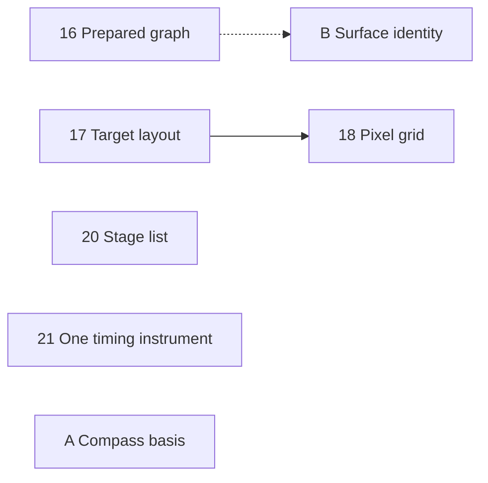

# The deepening plan: what is left, in the order it lands

This page is the architecture work still open in the tree: every deepening a
review has found that has not landed, written as one pull request each and
numbered in the order they are worth landing. Each section says what it builds
on and what it unblocks, the friction and the evidence for it, the shape the
change takes, the decisions the pull request has to make, and the gate that
closes it. A pull request that lands takes its section with it — the decision
moves to an ADR or the build log — and the numbers of the rest do not change,
so "builds on 7" keeps meaning the same thing.

The vocabulary is the design skill's: a **module** has an interface and an
implementation; it is **deep** when a small interface hides a lot of behavior;
a **seam** is where the interface lives, an **adapter** is what satisfies it
there, and one adapter is a hypothetical seam where two make a real one. Depth
buys callers **leverage** and maintainers **locality**. The deletion test —
does deleting the module concentrate complexity, or just move it — is what
separates a candidate from a pass-through.

Every figure and line reference below is read from the tree at `96bdc2fd`;
nothing was run unless the section says so. Line numbers drift; the symbol beside each one is
the reference.

---

## In the tree

The deepenings already landed, each carrying its reasoning in its own file:

| Landed                                                       | Where                                                                                                                              |
| ------------------------------------------------------------ | ---------------------------------------------------------------------------------------------------------------------------------- |
| The band stack's composition is one description              | [`packages/universe/src/bandStack.ts`](../../packages/universe/src/bandStack.ts), ADR-0023 § Consequences                          |
| A mesh that wears the ground is dressed in one place         | [`apps/game/src/render/groundWear.ts`](../../apps/game/src/render/groundWear.ts), `render/wear.ts`                                 |
| The harness is built over one host                           | `Host` and `renderHost` in [`packages/devtools/src/harness.ts`](../../packages/devtools/src/harness.ts)                            |
| The preference registry owns every knob the frame loop reads | [`apps/game/src/state/engineKnobs.ts`](../../apps/game/src/state/engineKnobs.ts)                                                   |
| The entity store hands out its read half                     | `EntityView` in [`packages/simulation/src/entity.ts`](../../packages/simulation/src/entity.ts), `spawnShip`                        |
| The heightfield request carries the surface                  | `HeightfieldSource.submit(surface, request)` and `WireSurface` in `packages/workers/src/tasks.ts`, ADR-0023 § 3                    |
| A body's visual residency is a policy that runs in Node      | [`apps/game/src/scene/bodyResidency.ts`](../../apps/game/src/scene/bodyResidency.ts) and its test                                  |
| On foot is a session verb                                    | [`packages/devtools/src/onFoot.ts`](../../packages/devtools/src/onFoot.ts), ADR-0047                                               |
| The flying verbs are a module                                | [`packages/devtools/src/maneuvers.ts`](../../packages/devtools/src/maneuvers.ts) and its test                                      |
| Time has one writer                                          | [`apps/game/src/hud/time.ts`](../../apps/game/src/hud/time.ts) and its test                                                        |
| The ground under a walker is one module                      | [`packages/rendering/src/ground.ts`](../../packages/rendering/src/ground.ts), `supportUnder`, rule 53                              |
| The walker's presentation is a function                      | [`apps/game/src/engine/onFootPresentation.ts`](../../apps/game/src/engine/onFootPresentation.ts) and its test                      |
| A body's uniforms are a pure mapping                         | [`apps/game/src/render/bodyUniforms.ts`](../../apps/game/src/render/bodyUniforms.ts) and its test                                  |
| The frame's owner is named once                              | [`apps/game/src/engine/frameOwner.ts`](../../apps/game/src/engine/frameOwner.ts), `engine.owner`, rule 31                          |
| The engine's derived state keys on one generation            | [`engine/starSurvey.ts`](../../apps/game/src/engine/starSurvey.ts), `engine/orbitTraces.ts` and their tests                        |
| The director is a sub-object, and the app says it has booted | `ir.cutscene`, `openSession({ cutscenes })`, `ir.status().boot`, `scripts/drive.mjs`                                               |
| The guide's wire contract is one module                      | [`packages/protocol/src/guideWire.ts`](../../packages/protocol/src/guideWire.ts) and its test                                      |
| The game holds one guide verdict per mode                    | [`apps/game/src/tour/verdict.ts`](../../apps/game/src/tour/verdict.ts), `mountGuide`, and their tests                              |
| The Worker decides "configured" once                         | `guideAccess` in [`apps/server/src/tour/access.ts`](../../apps/server/src/tour/access.ts), ADR-0048                                |
| The Live channel speaks in verbs                             | [`apps/game/src/tour/channel.ts`](../../apps/game/src/tour/channel.ts), `liveFake.ts`, `endsStop`, ADR-0042                        |
| The heightfield archive is one object                        | `HeightfieldArchive` in `packages/workers/src/heightfieldCache.ts`, the fingerprint test, ADR-0045                                 |
| A body the kernel cannot pack goes to the pool alone         | `refuse` in [`apps/game/src/render/terrainProducer.ts`](../../apps/game/src/render/terrainProducer.ts) and its GPU test            |
| One water decision per patch                                 | `patchWater` in [`packages/rendering/src/terrainPalette.ts`](../../packages/rendering/src/terrainPalette.ts), `patchWater.test.ts` |
| One quad-pass runner                                         | `runQuadPasses` in [`apps/game/src/render/quadPass.ts`](../../apps/game/src/render/quadPass.ts) and its GPU test                   |

---

## The order

| #   | Pull request                                                                                                 | Track       | Builds on | Strength        |
| --- | ------------------------------------------------------------------------------------------------------------ | ----------- | --------- | --------------- |
| 16  | [The drainage graph is prepared off the draw thread](#16-the-drainage-graph-is-prepared-off-the-draw-thread) | The terrain | —         | Worth exploring |
| 17  | [The scene target's layout is one table](#17-the-scene-targets-layout-is-one-table)                          | The picture | —         | Strong          |
| 18  | [The sensor publishes the frame's pixel grid](#18-the-sensor-publishes-the-frames-pixel-grid)                | The picture | 17        | Worth exploring |
| 20  | [The optical chain is a list of stages](#20-the-optical-chain-is-a-list-of-stages)                           | The picture | —         | Worth exploring |
| 21  | [GPU timing is one instrument](#21-gpu-timing-is-one-instrument)                                             | The picture | —         | Worth exploring |
| A   | [One compass basis](#a-one-compass-basis)                                                                    | Optional    | —         | Speculative     |
| B   | [Surface identity is stated once](#b-surface-identity-is-stated-once)                                        | Optional    | 16        | Speculative     |

**Every pull request builds only on ones numbered before it, and within a track
the numbering is the order to take them in. Across tracks the only edges are
the two optional items.** So the tracks fan out across worktrees, and
the numbering is the order for one pair of hands. Where a pull request builds
on nothing and still has a place in the order, the place is about collision,
and its section says so. One file is edited by more than one pull request,
and the order is what keeps them apart:

- `apps/game/src/render/sensor.ts` — 17, 18, 20 and 21, in that order.

**Start with 17, after one decision.** The guide track is in the tree, and so
are the archive, the per-body refusal, the water decision and the quad-pass
runner. What is left of the terrain track is 16, which waits on a measurement;
of the picture track, 18 and 21 wait on measurements and 20 waits on a fourth
stage. 17 is open on a question its section names: where the warm-up reads
the layout once the module-level map is gone.
[Open from the review of 6–11](#open-from-the-review-of-611) holds the smaller
follow-ups those pull requests left, none of them a pull request of its own.

---

## 16. The drainage graph is prepared off the draw thread

**Track:** the terrain · **Worth exploring**, **measure first** ·
local-substitutable (the inline pool)

**Builds on:** nothing left open — a surface the kernel cannot pack is already
a per-body answer in the producer (`refuse`), and preparation is what gives
it. **Unblocks:**
[B](#b-surface-identity-is-stated-once).

**Precondition.** [Perf](perf.md#the-first-tile-of-a-wet-body-builds-its-drainage-graph-on-the-draw-thread-unmeasured)
has the measurement this waits on. If the build lands behind the boot cover or
an arrival cut rather than in a frame a player is watching, the pull request is
the tests below and nothing moves.

**Files.** `packages/universe/src/drainage.ts` (`drainageGraph`, memoized per
thread up to `DRAINAGE_CACHE_LIMIT`, twelve), `packages/universe/src/terrainKernel.ts`
(`surfaceKernel`), `apps/game/src/render/terrainProducer.ts` (`pump`),
`apps/game/src/engine/scatterField.ts`, `apps/game/src/engine/terrainStreamer.ts`
(the detail floor's off-thread protocol, `:1422–1471`).

**The friction.** Nothing says whether a body's graph is ready; each thread
builds one on first use. On the draw thread the first asker pays: the GPU
producer's `pump` calls `surfaceKernel`, which builds and packs the graph
synchronously — 50 to 110 ms a body, cold in Node
([ADR-0043](../../docs/adr/0043-the-rivers-drain.md)); the browser figure is not
measured. The streamer already runs a hand-built off-thread protocol with a
fallback for the detail floor, and none of its three failure branches has a
test.

**The shape.** Per-surface preparation: `prepare(surface)` answers ready,
pending or refused. It builds the floor, the graph and the packed kernel record
off the draw thread and transfers the typed arrays to seed the draw thread's
memo, and the producer asks it per surface.

**Gate.** A build counter shows the draw thread builds no graph during a
headless descent onto a wet body. The floor's three failure branches get tests
over the inline pool. The perf figure is re-measured at the same operating
point after.

---

## 17. The scene target's layout is one table

**Track:** the picture · **Strong** · local-substitutable (Dawn)

**Builds on:** nothing. **Unblocks:** 18, and makes
[the upscaler](the-upscaler.md#the-velocity-attachment-does-not-mask-its-overlays)'s
velocity-overlay defect one change.

**Files.** `apps/game/src/render/sensor.ts` (`declareSceneTarget` at `:106`,
the warm-up stand-in at `:198–220`, the live pass patch at `:305–354`),
`apps/game/src/render/sensorMrt.ts`, `apps/game/src/render/warmup.ts`
(`:171–194`), `apps/game/src/render/createRenderer.ts` (`:250–255`), and the GPU
tests that declare their own targets: `cameraSensor`, `sensor`, `galaxyVolume`,
`galaxyVolumeCache`, `galaxyDaylight`, `optics`, `sensorMotion`, `upscale` and
`warmup`, plus `radianceReactivity`, which builds one by hand.

**The friction.**

- **Each attachment's name, format and blend is written three times:** the
  warm-up stand-in sets the count, the names and the formats; `createSensor`
  sets the formats again on the live pass's textures; `sensorMrt` sets the names
  and the blend modes. Production builds five — `output`, `motion`,
  `meterMask`, `velocity`, `reactive`.
- **The layout is ambient.** Only `createRenderer` declares `optics: true`, and
  the sensor reads the shape from a module-level map keyed on the renderer, so
  the GPU suite declares its own: eighteen `declareSceneTarget` calls across
  nine files. `upscale.gpu.test.ts` ties `optics` to whether a frame callback was
  passed, which production never does, and `radianceReactivity.gpu.test.ts`
  builds its target by hand.

**The shape.** A pure layout derived from the resolved picture and the backend
— rows of name, format and blend — builds the stand-in, the live pass, the MRT
node and the byte count, and `createSensor` takes the layout as an argument
instead of reading the map. [ADR-0044](../../docs/adr/0044-the-sensor-reconstructs-the-display.md)
already says `declareSceneTarget` carries the samples, formats and layout to
both the stand-in and the live pass; this makes it one table they are built
from.

**Open before starting.** Twelve scene components warm through
`warmRenderer(gl)`, holding R3F's renderer and nothing else, and the warm-up
reads the layout from the map by that renderer. Removing the map means one of:
a context the components read the layout from; deriving it in the warm-up from
the picture preference and the backend, as `createSensor` does, with the
stand-in cached by layout rather than by renderer; or the layout carried on
the renderer object, which is the map under another name. The first is churn
across twelve components, the second is two readers of the preference that
must agree, and the gate refuses the third.

**Gate.** A Node test over the rows: an attachment whose blend reads alpha has
four channels, the constraint Dawn enforces and the upscaler plan names. The GPU
tests take production's layout. No module-level renderer map remains. The
velocity-overlay fix, whichever candidate the upscaler plan picks, is then one
row.

---

## 18. The sensor publishes the frame's pixel grid

**Track:** the picture · **Worth exploring**, **measure first** · in-process

**Builds on:** 17 — the layout and the grid are derived from the same resolved
picture. **Unblocks:** nothing.

**Files.** `apps/game/src/render/sensor.ts` (`:322`),
`apps/game/src/render/upscale.ts` (`:192`), `apps/game/src/render/picture.ts`
(`pictureDimensions`), `apps/game/src/scene/Sensor.tsx` (`:80–84`),
`apps/game/src/render/createRenderer.ts` (`:246`),
`apps/game/src/scene/TerrainPatches.tsx` (`:140–146`),
`apps/game/src/scene/WaterPatches.tsx` (`:79–84`),
`apps/game/src/render/terrain.ts` (the detail fade, `:501–508`).

**The friction.**

- **Two formulas for the render size.** Three's pass computes `floor(w·(1/r))`
  and the upscaler `floor(w/r)`. They agree for every width from 1 to 7,999 at
  the four ratios — checked in Node — by the behavior of the floats, not by
  construction.
- The picture is resolved three times, and "does this picture upscale" is
  written twice.
- **The pixel angle may not match the grid the samples land on.** Terrain and
  water divide the display's pixel angle by the drawing buffer's height. Under a
  reduced render scale the samples land on a grid `r` times coarser than that
  angle assumes, so the detail fade may under-filter — for spatial FSR at least;
  temporal reconstruction may justify the display-rate figure. Not measured.

**The shape.** The sensor resolves the render size, the sample-grid ratio and
the upscale path once and publishes them, and the pixel-angle writers read
that. `RENDER_AA` and the screen-resolution multiplier stay where they are; see
[below](#what-the-landed-deepenings-left-deliberately).

**Precondition.** Plates at a reduced render scale, in daylight, at Sol and at a
generated world, show whether the under-filtering is visible. If it is not, the
pull request is the one formula and the one resolution, and the pixel angle
stays.

**Gate.** A Node test of the resolved grid and the per-sample angle at each
ratio. If the angle changes, plates either side at the same two operating
points.

---

## 20. The optical chain is a list of stages

**Track:** the picture · **Worth exploring** · local-substitutable (Dawn)

**Builds on:** nothing left open — every stage already draws through
`runQuadPasses`. **Unblocks:** nothing.

**Files.** `apps/game/src/render/sensor.ts` (`:289–739`), the three optical
stages, `docs/guides/harness.md` (the pass list), `optics.gpu.test.ts`.

**The friction.** Adding an optical stage touches about nine places: in
`sensor.ts`, construction, the next stage's input, the dependency sum, warm-up,
disposal, `SensorDiagnostics` and the per-frame writes; then the timeline name,
the pass list in `harness.md`, and a GPU test.

**The shape.** A stage exposes its name, its output, a per-frame update, warm,
dispose and diagnostics, and the sensor walks the list for each. Chain wiring
and bypass become testable in Node with fake stages, and
[ADR-0031](../../docs/adr/0031-the-sensor-response.md)'s sensor already calls
`warm` and reads `outputTexture` without looking inside a pass.

**Weigh it.** Three stages make the seam real and also make the list close to a
framework. Take it with the fourth stage, not before.

**Gate.** `optics.gpu.test.ts`'s "warms every pass" becomes a check over the
list: every stage warmed, named and disposed.

---

## 21. GPU timing is one instrument

**Track:** the picture · **Worth exploring** · local-substitutable (Dawn), and
true external for `@pmndrs/upscaler`'s private timer

**Builds on:** nothing left open — every pass has a name to be timed under
(`runQuadPasses`); 20 if it has landed. **Unblocks:** nothing.

**Files.** `apps/game/src/render/gpuTiming.ts` (`RenderTimestampDrain`,
`installGpuTiming`, `beginGpuTiming`, `endGpuTiming`),
`apps/game/src/render/passTimeline.ts` (`summarize`),
`apps/game/src/render/upscale.ts` (the private `_timer` read at `:170`),
`apps/game/src/render/measure.ts`, `apps/game/src/hud/PerfPanel.tsx`,
`docs/guides/harness.md`.

**The friction.** Three timestamp mechanisms, with two meanings.

- `gpuTiming.ts` turns on three's timestamp tracking and drains it every frame.
  `measure.ts` records that three's own timestamp figure double-counts when
  there is a canvas output pass, and there always is one.
- `passTimeline` installs over the backend and cannot see the upscaler's compute
  passes; `harness.md` says they show only as gaps.
- The upscaler reads raw begin-to-end pairs from the package's private `_timer`
  and `PerfPanel` shows them. `passTimeline` argues that on Apple GPUs a raw
  pair measures latency, not cost, and ADR-0044's reconstruction figures are
  raw pairs.

**The shape.** One instrument per renderer, with an adapter that feeds the
upscaler's intervals into `summarize`, so `ir.passes` includes reconstruction.
`gpuTiming.ts` goes unless the pull request finds a reader that needs three's
own figure.

**Gate.** `summarize` over foreign intervals is tested in Node. On the GPU, a
temporal sensor's busy time is close to its wall time. ADR-0044's reconstruction
figures are re-measured through the one instrument and the ADR amended. Rule 65
binds: the instrument never changes the frame or stops it.

**Open before starting.** Whether the package's `takeSamples()` exposes raw
begin and end timestamps is not checked. Removing three's timestamps touches
what ADR-0044 promises for `ir.timing('full')`. The private field is re-tested
on every bump of the package.

---

## A. One compass basis

**Optional** · **Speculative** · in-process

**Slots in:** anywhere. `OnFoot.site` steps out at heading 0; a walker that
steps out facing the way its ship faces needs this first.

**The friction.** "East" at a surface point is derived four ways. `placementBasis`
(`packages/simulation/src/surfacePlacement.ts`) takes `cross(+Y, up)`;
`installSurfaceFrame` (`packages/universe/src/frames.ts`) takes
`(-up.z, 0, up.x)`, its negation; `spawnCharacter` re-derives the basis in
another closed form; `OnFoot.site` computes a third; the camera's
tests use `localTriad`. Nothing is wrong today, because every heading derived
this way is 0. It is a trap for the first heading taken from a landed ship.

**The shape.** `compassBasis(latitude, longitude, heading)` in
`packages/universe`, read by all four.

---

## B. Surface identity is stated once

**Optional** · **Speculative** · in-process

**Builds on:** 16, whose key it would replace, and the archive's, which is in
the tree.

**The friction.** Four keys answer "which surface is this": the drainage memo's,
the survey's, the archive's and the sketch's. The drainage and survey keys list
the five `SurfaceParameters` fields by hand plus `JSON.stringify(grammar)`,
which turns NaN and ±∞ into `null` — the archive module's own comment says so —
so distinct surfaces can share a key. The complete serializer, `stable()`, is in
`packages/workers`, out of `packages/universe`'s reach by layer. `sketch.ts`'s
comment names the collision a hand-listed key produces (the `air` field).
The DEM work in [terrain § 1](terrain.md#1-scope) adds a surface input.

**The shape.** `surfaceIdentity(surface)` in `packages/universe`, memoized per
object; the drainage, survey and archive keys read it, and the sketch keeps its
deliberately narrower key. One fast-check property — perturbing any field moves
the identity — replaces the hand-written key cases in
`heightfieldCache.test.ts`.

---

## Open from the review of 6–11

What the reviews of 6–11 found and did not fix, by track. None is a pull
request of its own; each belongs to the next change that opens its file.

**The walker and the frame.**

- **Observatory ownership is still spelled out twice in `GameEngine.ts`.**
  `galaxyInstrument` and `galaxyView` test `cinematic === null` and
  `observer !== null` together, which is `owner?.arm === 'observatory'`.
  Correct, and allowed inside the engine; `owner.arm` says it once.
- **The plumes and the parked hull can part.** On foot `ThrusterFx` roots its
  plumes at the vessel entity's pose; `ShipModel` draws a parked Rocinante at
  the raised, upright pad pose. They differ only if a parked hull reports a
  thrust demand, and nothing shows one never does. Either root the plumes at
  `engine.parkedRocinante`, or hold a parked hull's demand at zero in a test.
- **The derived-state test counts its own probes, not the fields.** Its count
  makes a deleted probe loud and cannot see a field added to
  `#invalidateDerived` without one; `rotationStop` and `terrain` are never warm
  at the pad, so their cold read proves only that they do not throw.
- **6's gate is short two plates.** No plate was taken of a figured body or of
  the star filling the frame; the figured path is equivalent in code and the
  star's exposure is held by `bodyUniforms.test.ts`. The per-body records it
  builds every frame are a GC producer in [perf](perf.md#garbage-collection-eats-35-of-the-main-thread-at-idle),
  unmeasured.

**The harness.**

- **The driver cannot tell a reload from the page it left.** In app mode the
  post-navigate poll does not check that the new document committed, so a
  booted page the navigation has not yet replaced can read ready. Matching the
  navigation's loader, as document mode does, times out a cold boot: Vite
  reloads the page once after optimizing its dependencies, and the loader
  changes. The check is "the loader is not the one before the navigation". The
  one unexplained cold `engine is not defined` 9 recorded may be this; it is
  not reproduced.
- **A baseline from before `ir.status().boot` costs twelve seconds a plate.**
  The driver reads such a build as `drawing` and the cover wait gives up after
  twelve seconds, which is correct and slow; it ages out as baselines move past 9.
- **The director still calls `host.render.declareCut()`.** 9's shape did not
  move it.

**The guide.**

- **A voice added to `GUIDE_VOICES` refuses the whole verdict on a stale page.**
  The decoder is strict, so a page loaded before the deploy reads the new
  answer as not offered until it reloads — the same skew 10 accepted for the
  shape change.
- **`useGuideAccess` waiting for the account provider has no test.** It is a
  hook and the suite runs in Node; the verdict it feeds is tested.
- **The 1,500-byte scene bound is the adapter's own.** No provider limit is
  documented in `openaiLive.ts` or ADR-0042; if one exists, cite it there.

---

## Open from 11–15 and 19

What those pull requests found and did not fix. None is a pull request of its
own.

- **`upscale.gpu.test.ts` flakes.** "samples GPU passes only on request and
  drains renderer query pools" fails with `expected 0 to be greater than 0`
  about one run in two on an unchanged tree, alone or in the suite, on this
  Mac through Dawn. It touches nothing the runner changed; 21 opens the file.
- **Two galaxy passes are named and not measured.** `quadPass.gpu.test.ts`
  finds every optical pass and the volume's, rays and history by name;
  `galaxy structure` draws inside an asynchronous warm and `galaxy sky` behind
  the cube cache, so neither is inside a measured frame there. Both draw
  through the runner, which names every draw.
- **The fingerprint pins the CPU tile on one machine's arithmetic.** It held on
  CI's Linux runner on its first push; a host where V8's float functions
  differ would fail it with the message to spend a version, which there would
  be wrong.

---

## What the landed deepenings left, deliberately

- **The band stack's bodies are still two.** The kernel does not walk
  `BAND_STACK`; it reads its gates from it. A kernel that walked the table would
  be the scalar mirror ADR-0023 refuses, one level up, and the tolerance test is
  left holding exactly the arithmetic only it can hold.
- **The world-replaced rule is still six checks.** The director's identity
  checks, the observatory's guards and the engine's derived-state list each
  answer a different consequence of the same event, and each is correct
  locally. The session's `onWorldReplaced` option is the engine's subscription;
  letting the director and the observatory register on it instead of checking
  is a separate design, built on the world generation the engine names.
- **`RENDER_HDR` and `RENDER_AA` stay in `App`.** Both are facts about the
  renderer it builds — a constructor argument and the drawing buffer's ratio —
  and the canvas key reads them. `RENDER_AA` is also bound by the registry, for
  the supersample factor the terrain predicate divides back out; 18 reads that
  and does not move it.
- **The streamer still caches the palette for the renderer.** `TerrainState`
  carries `palette`, `datumRadius`, `orientation`, `center` and `lens` so the
  renderer has them in the frame the drawn set is empty. Small, and its home is
  `TerrainPatches` reading the body.
- **`engine.pool()` stays.** `scene/Bodies.tsx` and `render/preload.ts` read
  the pool through it; when both read the session it goes, as `player()` did.
- **The cinema playhead keeps its `mine` guard.** With the director on
  `ir.cutscene` a console `ir.play` can still replace a scene the session
  opened, and the guard is what keeps the session from claiming that ending.
- **The Saturn frame-spike figure is not re-measured:** worst main-thread frame
  2.3 ms across a warm Saturn approach, zero over 8 ms. `ir.profile` over a
  Saturn approach with `?presentation=occluded` reads it, and the caveats in
  [perf](perf.md) apply.

---

## Judged deep, and left alone

Each was walked and found deep enough that lifting anything out would move
complexity rather than concentrate it.

- **`apps/server/src/account.ts`** — `verifySession`, `identify` and
  `privateMetadata` over key-set freshness, the abandoned fetch and the grant's
  one-minute hold. Clerk is imported there and under `apps/game/src/account/`
  only, and the tests sign real RS256 tokens (`testTokens.ts`).
- **`GuideLifetime` and `mountGuide`** — a small interface, with the StrictMode
  and late-import cases tested; `GuideHost` and `GuideLoop`'s channel already
  have in-memory implementations, so the tool loop is tested without a
  provider.
- **The dock's `suppressed` flag** — generic; only the registry knows about the
  guide.
- **`stepCharacter` behind `CharacterGround`** — deep, with two real adapters,
  the world and the motion tests' fakes. The motor stays one module.
- **The relief table and `surfaceSupportRadius`'s two-stage miss** — pure and
  well placed, and the relief check holds the table to the pad's model.
- **`CharacterInput` and `PointerLock`** — small, and each holds real behavior:
  the held set, the double tap, lock ownership.
- **`render/rendererLifetime.ts`** — the teardown order is the module, its
  mechanisms are handed in, and seven Node tests hold the ordering.
- **`passTimeline.summarize`** — pure, and tested against stale query slots and
  overlapping passes.
- **The sensor's state restore in `finally`** — `sensor.gpu.test.ts` holds it
  with a real throw.
- **The `Heightfields` router** — three adapters (pool, GPU, the cache) behind
  a small interface, with direct tests; the streamer never sees the cache.
- **`terrainStreamer.ts`'s selection, budgets and epochs** — deep where it
  matters and driven through `update()` and `summary()`. Its one drainage
  coupling is a boolean.
- **CPU/GPU parity for the drainage cut** — held at one seam: `uploadSurface`
  feeds the producer and both tolerance tests, and both sides read
  `DRAINAGE_SHAPE`.

---

## Settled, not reopened

Named here so a later review does not relitigate them; each has a home that
carries the argument.

- **Per-route Open Graph at request time** — settled by prerendering: Astro
  renders every public route's head at build time through
  `src/documentHead.ts`, and [`docs/hosting.md`](../../docs/hosting.md) names
  request-time rendering as an adapter choice nothing has configured.
- **Generating the document** — there is no `index.html` to generate:
  `src/documentHead.ts` renders the head and `scripts/brand/checkHead.mjs`
  gates it without a build. The brand assets are the one generated set, and
  [`scripts/brand/build.mjs`](../../scripts/brand/build.mjs) carries the
  reasoning.
- **Anything multiplayer** —
  [ADR-0008](../../docs/adr/0008-multiplayer-partitions.md) is design-only, and
  the single `AuthorityPort` adapter cannot rot because no `if (online)` branch
  exists.
- **Wiring `World.updateInterest`** — a gameplay decision, per the build log.
- **A kernel that walks the band stack's table** — the scalar mirror
  [ADR-0023](../../docs/adr/0023-the-gpu-producer.md) refuses; the table is a
  description.
- **A whole-store write verb on the world** — the store's write half is the
  world's alone by `EntityView`; a ship that starts moving is spawned moving,
  and every later write is a verb that carries its bookkeeping.

---

## Related

- [ADR index](../../docs/adr/README.md) — the decisions each pull request sits
  under
- [Terrain](terrain.md) · [Erosion](erosion.md) — the terrain track's
  neighbors: the archive's write lock and cross-app import, defects 2 and 14
- [Perf](perf.md) — the measurement 16 waits on
- [The upscaler](the-upscaler.md) — the velocity-overlay defect 17 makes one
  change
- [Harness](../../docs/guides/harness.md) — the console surface, with
  `ir.cutscene` and `ir.status().boot`
