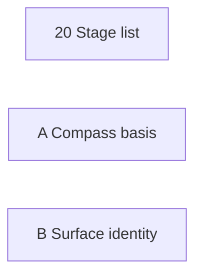

# The deepening plan: what is left, in the order it lands

This page is the architecture work still open in the tree: every deepening a
review has found that has not landed, written as one pull request each and
numbered in the order they are worth landing. Each section says what it builds
on and what it unblocks, the friction and the evidence for it, the shape the
change takes, the decisions the pull request has to make, and the gate that
closes it. A pull request that lands takes its section with it — the decision
moves to an ADR or the build log — and the numbers of the rest do not change,
so "builds on 7" keeps meaning the same thing.

The vocabulary is the design skill's: a **module** has an interface and an
implementation; it is **deep** when a small interface hides a lot of behavior;
a **seam** is where the interface lives, an **adapter** is what satisfies it
there, and one adapter is a hypothetical seam where two make a real one. Depth
buys callers **leverage** and maintainers **locality**. The deletion test —
does deleting the module concentrate complexity, or just move it — is what
separates a candidate from a pass-through.

Every figure and line reference below is read from the tree at `96bdc2fd`;
nothing was run unless the section says so. Line numbers drift; the symbol beside each one is
the reference.

---

## In the tree

The deepenings already landed, each carrying its reasoning in its own file:

| Landed                                                       | Where                                                                                                                                                                    |
| ------------------------------------------------------------ | ------------------------------------------------------------------------------------------------------------------------------------------------------------------------ |
| The band stack's composition is one description              | [`packages/universe/src/bandStack.ts`](../../packages/universe/src/bandStack.ts), ADR-0023 § Consequences                                                                |
| A mesh that wears the ground is dressed in one place         | [`apps/game/src/render/groundWear.ts`](../../apps/game/src/render/groundWear.ts), `render/wear.ts`                                                                       |
| The harness is built over one host                           | `Host` and `renderHost` in [`packages/devtools/src/harness.ts`](../../packages/devtools/src/harness.ts)                                                                  |
| The preference registry owns every knob the frame loop reads | [`apps/game/src/state/engineKnobs.ts`](../../apps/game/src/state/engineKnobs.ts)                                                                                         |
| The entity store hands out its read half                     | `EntityView` in [`packages/simulation/src/entity.ts`](../../packages/simulation/src/entity.ts), `spawnShip`                                                              |
| The heightfield request carries the surface                  | `HeightfieldSource.submit(surface, request)` and `WireSurface` in `packages/workers/src/tasks.ts`, ADR-0023 § 3                                                          |
| A body's visual residency is a policy that runs in Node      | [`apps/game/src/scene/bodyResidency.ts`](../../apps/game/src/scene/bodyResidency.ts) and its test                                                                        |
| On foot is a session verb                                    | [`packages/devtools/src/onFoot.ts`](../../packages/devtools/src/onFoot.ts), ADR-0047                                                                                     |
| The flying verbs are a module                                | [`packages/devtools/src/maneuvers.ts`](../../packages/devtools/src/maneuvers.ts) and its test                                                                            |
| Time has one writer                                          | [`apps/game/src/hud/time.ts`](../../apps/game/src/hud/time.ts) and its test                                                                                              |
| The ground under a walker is one module                      | [`packages/rendering/src/ground.ts`](../../packages/rendering/src/ground.ts), `supportUnder`, rule 53                                                                    |
| The walker's presentation is a function                      | [`apps/game/src/engine/onFootPresentation.ts`](../../apps/game/src/engine/onFootPresentation.ts) and its test                                                            |
| A body's uniforms are a pure mapping                         | [`apps/game/src/render/bodyUniforms.ts`](../../apps/game/src/render/bodyUniforms.ts) and its test                                                                        |
| The frame's owner is named once                              | [`apps/game/src/engine/frameOwner.ts`](../../apps/game/src/engine/frameOwner.ts), `engine.owner`, rule 31                                                                |
| The engine's derived state keys on one generation            | [`engine/starSurvey.ts`](../../apps/game/src/engine/starSurvey.ts), `engine/orbitTraces.ts` and their tests                                                              |
| The director is a sub-object, and the app says it has booted | `ir.cutscene`, `openSession({ cutscenes })`, `ir.status().boot`, `scripts/drive.mjs`                                                                                     |
| The guide's wire contract is one module                      | [`packages/protocol/src/guideWire.ts`](../../packages/protocol/src/guideWire.ts) and its test                                                                            |
| The game holds one guide verdict per mode                    | [`apps/game/src/tour/verdict.ts`](../../apps/game/src/tour/verdict.ts), `mountGuide`, and their tests                                                                    |
| The Worker decides "configured" once                         | `guideAccess` in [`apps/server/src/tour/access.ts`](../../apps/server/src/tour/access.ts), ADR-0048                                                                      |
| The Live channel speaks in verbs                             | [`apps/game/src/tour/channel.ts`](../../apps/game/src/tour/channel.ts), `liveFake.ts`, `endsStop`, ADR-0042                                                              |
| The heightfield archive is one object                        | `HeightfieldArchive` in `packages/workers/src/heightfieldCache.ts`, the fingerprint test, ADR-0045                                                                       |
| A body the kernel cannot pack goes to the pool alone         | `refuse` in [`apps/game/src/render/terrainProducer.ts`](../../apps/game/src/render/terrainProducer.ts) and its GPU test                                                  |
| One water decision per patch                                 | `patchWater` in [`packages/rendering/src/terrainPalette.ts`](../../packages/rendering/src/terrainPalette.ts), `patchWater.test.ts`                                       |
| One quad-pass runner                                         | `runQuadPasses` in [`apps/game/src/render/quadPass.ts`](../../apps/game/src/render/quadPass.ts) and its GPU test                                                         |
| The drainage graph is prepared off the draw thread           | `SurfacePreparation` in [`packages/workers/src/surfacePreparation.ts`](../../packages/workers/src/surfacePreparation.ts) and its test                                    |
| The scene target's layout is one table                       | `sceneLayout` in [`apps/game/src/render/sceneLayout.ts`](../../apps/game/src/render/sceneLayout.ts), `engine.sceneLayout`, and its test                                  |
| One render size and one resolution                           | `renderSize` and `pictureUpscales` in [`apps/game/src/render/picture.ts`](../../apps/game/src/render/picture.ts), `SceneLayout.picture`, and their tests                 |
| GPU timing is one instrument                                 | `PassSource` and `owned` in [`apps/game/src/render/passTimeline.ts`](../../apps/game/src/render/passTimeline.ts), the upscaler's source in `render/upscale.ts`, ADR-0044 |

---

## The order

| #   | Pull request                                                                       | Track       | Builds on | When                 |
| --- | ---------------------------------------------------------------------------------- | ----------- | --------- | -------------------- |
| 20  | [The optical chain is a list of stages](#20-the-optical-chain-is-a-list-of-stages) | The picture | —         | With iris sampling   |
| A   | [One compass basis](#a-one-compass-basis)                                          | The frame   | —         | Decided              |
| B   | [Surface identity is stated once](#b-surface-identity-is-stated-once)              | Terrain     | —         | Next terrain version |

**Every pull request builds only on ones numbered before it, and within a track
the numbering is the order to take them in. Nothing left crosses a track.**

**What is left waits on something.** The guide and terrain tracks are in the
tree, and of the picture track everything but 20, which waits on a fourth
optical stage, which is per-glass iris sampling. A is decided and takes a save
version; B rides the next terrain version. Each section says what it costs.
[Open from the review of 6–11](#open-from-the-review-of-611) and the lists
after it hold the smaller follow-ups those pull requests left, none of them a
pull request of its own.

---

## 20. The optical chain is a list of stages

**Track:** the picture · **With iris sampling** · local-substitutable (Dawn)

**Builds on:** nothing left open — every stage already draws through
`runQuadPasses`. **Unblocks:** nothing.

**Files.** `apps/game/src/render/sensor.ts` (`:289–739`), the three optical
stages, `docs/guides/harness.md` (the pass list), `optics.gpu.test.ts`.

**The friction.** Adding an optical stage touches about nine places: in
`sensor.ts`, construction, the next stage's input, the dependency sum, warm-up,
disposal, `SensorDiagnostics` and the per-frame writes; then the timeline name,
the pass list in `harness.md`, and a GPU test.

**The shape.** A stage exposes its name, its output, a per-frame update, warm,
dispose and diagnostics, and the sensor walks the list for each. Chain wiring
and bypass become testable in Node with fake stages, and
[ADR-0031](../../docs/adr/0031-the-sensor-response.md)'s sensor already calls
`warm` and reads `outputTexture` without looking inside a pass.

**Weigh it.** Three stages make the seam real and also make the list close to a
framework. Take it with the fourth stage, not before.

**Decided: the fourth stage is per-glass iris sampling, and the list lands in
the same change.** It is the first row of
[the camera beyond the three modes](../../docs/roadmap.md#the-camera-beyond-the-three-modes):
the glass records exist, and the check is blur shape plus the half-pixel
defocus gate.

**Gate.** `optics.gpu.test.ts`'s "warms every pass" becomes a check over the
list: every stage warmed, named and disposed.

---

## A. One compass basis

**Track:** the frame · **Decided** · in-process

**Slots in:** anywhere. `OnFoot.site` steps out at heading 0; a walker that
steps out facing the way its ship faces needs this first.

**The friction.** "East" at a surface point is derived four ways. `placementBasis`
(`packages/simulation/src/surfacePlacement.ts`) takes `cross(+Y, up)`;
`installSurfaceFrame` (`packages/universe/src/frames.ts`) takes
`(-up.z, 0, up.x)`, its negation; `spawnCharacter` re-derives the basis in
another closed form; `OnFoot.site` computes a third; the camera's
tests use `localTriad`. The first is geographic east — `geodeticDirection`'s
longitude increases along `cross(+Y, up)` — so the surface frame's +X points
west. A landed entity's orientation is stored relative to that frame, and
`ir.land` teleports a ship there at `Q.IDENTITY`, so making the surface frame
read the shared basis turns every `ir.land` placement and every landed ship in
a save 180° about up — a ship that lands by flight is reframed and keeps its
heading. The pull request either keeps the surface frame's axes and converts
at the boundary, or spends a version on what a save means. Nothing is wrong
today, because every heading derived this way is 0. It is a trap for the first
heading taken from a landed ship.

**The shape.** `compassBasis(latitude, longitude, heading)` in
`packages/universe`, read by all four.

**Decided: taken, and it spends a save version with no migration.** The
surface frame reads the shared basis, so its +X is geographic east, and a save
written under the old frame is not carried forward — backward compatibility of
saves is not a requirement here. The pull request bumps the save version and
says in its own body what an older save does on load: refused, or loaded with
its landed ships turned 180° about up.

---

## B. Surface identity is stated once

**Track:** terrain · **With the next terrain version** · in-process

**Builds on:** nothing left open. The drainage memo's key, which
`seedDrainageGraph` shares with the build, and the archive's are both in the
tree.

**The friction.** Four keys answer "which surface is this": the drainage memo's,
the survey's, the archive's and the sketch's. The drainage and survey keys list
the five `SurfaceParameters` fields by hand plus `JSON.stringify(grammar)`,
which turns NaN and ±∞ into `null` — the archive module's own comment says so —
so distinct surfaces can share a key. The complete serializer, `stable()`, is in
`packages/workers`, out of `packages/universe`'s reach by layer. `sketch.ts`'s
comment names the collision a hand-listed key produces (the `air` field).
The DEM work in [terrain § 1](terrain.md#1-scope) adds a surface input.

**The shape.** `surfaceIdentity(surface)` in `packages/universe`, memoized per
object; the drainage, survey and archive keys read it, and the sketch keeps its
deliberately narrower key. One fast-check property — perturbing any field moves
the identity — replaces the hand-written key cases in
`heightfieldCache.test.ts`.

**What it costs.** Every archive key changes, so every stored tile is a miss
once, and CI pays it as 13 did: until `main` holds the new archive, each pull
request's first run generates every tile of the slow descent (see "Open from
11–15 and 19").

**Decided: it rides the next terrain version.** That is the batch carrying
erosion defects 3 and 6 and Enceladus's stripe extent
([erosion § 6](erosion.md#6-phases)), so the archive is invalidated once for
all four rather than once each.

---

## Open from the review of 6–11

What the reviews of 6–11 found and did not fix, by track. None is a pull
request of its own; each belongs to the next change that opens its file.

**The walker and the frame.**

- **Observatory ownership is still spelled out twice in `GameEngine.ts`.**
  `galaxyInstrument` and `galaxyView` test `cinematic === null` and
  `observer !== null` together, which is `owner?.arm === 'observatory'`.
  Correct, and allowed inside the engine; `owner.arm` says it once.
- **The plumes and the parked hull can part.** On foot `ThrusterFx` roots its
  plumes at the vessel entity's pose; `ShipModel` draws a parked Rocinante at
  the raised, upright pad pose. They differ only if a parked hull reports a
  thrust demand, and nothing shows one never does. Either root the plumes at
  `engine.parkedRocinante`, or hold a parked hull's demand at zero in a test.
- **Two of the derived-state test's probes are never warm.** `rotationStop`
  and `terrain` are cold at the pad before the load, so their cold read after
  it proves only that they do not throw.
- **6's gate is short two plates.** No plate was taken of a figured body or of
  the star filling the frame; the figured path is equivalent in code and the
  star's exposure is held by `bodyUniforms.test.ts`. The per-body records it
  builds every frame are a GC producer in [perf](perf.md#garbage-collection-eats-35-of-the-main-thread-at-idle),
  unmeasured.

**The harness.**

- **The driver cannot tell a reload from the page it left.** In app mode the
  post-navigate poll does not check that the new document committed, so a
  booted page the navigation has not yet replaced can read ready. Matching the
  navigation's loader, as document mode does, times out a cold boot: Vite
  reloads the page once after optimizing its dependencies, and the loader
  changes. The check is "the loader is not the one before the navigation". The
  one unexplained cold `engine is not defined` 9 recorded may be this; it is
  not reproduced.
- **A baseline from before `ir.status().boot` costs twelve seconds a plate.**
  The driver reads such a build as `drawing` and the cover wait gives up after
  twelve seconds, which is correct and slow; it ages out as baselines move past 9.
- **The director still calls `host.render.declareCut()`.** 9's shape did not
  move it.

**The guide.**

- **A voice added to `GUIDE_VOICES` refuses the whole verdict on a stale page.**
  The decoder is strict, so a page loaded before the deploy reads the new
  answer as not offered until it reloads — the same skew 10 accepted for the
  shape change.
- **`useGuideAccess`'s wiring has no test.** `followAccount` holds the wait
  for the account provider; the effect that calls it, its dependency list and
  the store subscription are React, and the suite runs in Node.
- **The 1,500-byte scene bound is the adapter's own.** No provider limit is
  documented in `openaiLive.ts` or ADR-0042; if one exists, cite it there.

---

## Open from 11–15 and 19

What those pull requests found and did not fix. None is a pull request of its
own.

- **Two galaxy passes are named and not measured.** `quadPass.gpu.test.ts`
  finds every optical pass and the volume's, rays and history by name;
  `galaxy structure` draws inside an asynchronous warm and `galaxy sky` behind
  the cube cache, so neither is inside a measured frame there. Both draw
  through the runner, which names every draw.
- **The fingerprint pins the CPU tile on one machine's arithmetic.** It held on
  CI's Linux runner on its first push; a host where V8's float functions
  differ would fail it with the message to spend a version, which there would
  be wrong.

---

## Open from 16–18

- **The site list waits for a worker.** It fills 286 ms after focusing Earth
  and 163 ms after HIP 82724 IV, where it filled the frame after the click;
  the drop handle waits with it. The trade is the 57 to 103 ms build it no
  longer pays inside that frame.
- **A body reached by teleport can still build its graph here.** The contact
  test and the flight model sample the canonical field synchronously and
  cannot wait, so a `goTo` or `ir.land` onto unprepared ground pays the build
  once, in the frame of the cut. `ir.sites`, `ir.visit` with a site and
  `ir.descend` do the same from the console.
- **Every pool worker still builds its own graph.** Off the draw thread, and in
  [perf](perf.md#every-pool-worker-builds-a-wet-bodys-drainage-graph-for-itself-unmeasured)
  with the measurement that would say whether the ground waits on it.
- **The pixel angle stays the display's under a reduced render scale.** The
  terrain and water detail fades divide the display's pixel angle by the
  drawing buffer, so at a render ratio `r` they assume samples `r` times finer
  than the pass draws. Plates at `off:performance:off` (spatial, `r = 2`),
  1600×900, with the angle multiplied by `r` against without: 27 px apart at
  `earthrise` (Sol, the Moon, sun 24°) and 5,795 at `tau-ceti-dusk` (generated,
  sun 5°), where two boots of the unchanged build, one of them fresh, differ by
  56,267; the crops are indistinguishable. Not measured: the temporal path,
  which may justify the display rate outright, and a cast for shimmer, which
  the fade's unchanged output makes unlikely to differ. **Decided: the
  temporal path is measured before this closes** — a camera pan under
  temporal Quality, cast for shimmer, with and without the angle multiplied.
- **The Graphics panel resolves the picture it is editing for itself.** It
  shows the render size of the preference before the sensor rebuilds, through
  `pictureDimensions`, which now reads `renderSize`.

---

## What the landed deepenings left, deliberately

- **The band stack's bodies are still two.** The kernel does not walk
  `BAND_STACK`; it reads its gates from it. A kernel that walked the table would
  be the scalar mirror ADR-0023 refuses, one level up, and the tolerance test is
  left holding exactly the arithmetic only it can hold.
- **The world-replaced rule is still six checks.** The director's identity
  checks, the observatory's guards and the engine's derived-state list each
  answer a different consequence of the same event, and each is correct
  locally. The session's `onWorldReplaced` option is the engine's subscription;
  letting the director and the observatory register on it instead of checking
  is a separate design, built on the world generation the engine names.
- **`RENDER_HDR` and `RENDER_AA` stay in `App`.** Both are facts about the
  renderer it builds — a constructor argument and the drawing buffer's ratio —
  and the canvas key reads them. `RENDER_AA` is also bound by the registry, for
  the supersample factor the terrain predicate divides back out. The pixel
  angle reads it too, and stays the display's: see "Open from 16–18".
- **The streamer still caches the palette for the renderer.** `TerrainState`
  carries `palette`, `datumRadius`, `orientation`, `center` and `lens` so the
  renderer has them in the frame the drawn set is empty. Small, and its home is
  `TerrainPatches` reading the body.
- **`engine.pool()` stays.** `scene/Bodies.tsx` and `render/preload.ts` read
  the pool through it; when both read the session it goes, as `player()` did.
- **The cinema playhead keeps its `mine` guard.** With the director on
  `ir.cutscene` a console `ir.play` can still replace a scene the session
  opened, and the guard is what keeps the session from claiming that ending.
- **The Saturn frame-spike figure is not re-measured:** worst main-thread frame
  2.3 ms across a warm Saturn approach, zero over 8 ms. `ir.profile` over a
  Saturn approach with `?presentation=occluded` reads it, and the caveats in
  [perf](perf.md) apply.

---

## Judged deep, and left alone

Each was walked and found deep enough that lifting anything out would move
complexity rather than concentrate it.

- **`apps/server/src/account.ts`** — `verifySession`, `identify` and
  `privateMetadata` over key-set freshness, the abandoned fetch and the grant's
  one-minute hold. Clerk is imported there and under `apps/game/src/account/`
  only, and the tests sign real RS256 tokens (`testTokens.ts`).
- **`GuideLifetime` and `mountGuide`** — a small interface, with the StrictMode
  and late-import cases tested; `GuideHost` and `GuideLoop`'s channel already
  have in-memory implementations, so the tool loop is tested without a
  provider.
- **The dock's `suppressed` flag** — generic; only the registry knows about the
  guide.
- **`stepCharacter` behind `CharacterGround`** — deep, with two real adapters,
  the world and the motion tests' fakes. The motor stays one module.
- **The relief table and `surfaceSupportRadius`'s two-stage miss** — pure and
  well placed, and the relief check holds the table to the pad's model.
- **`CharacterInput` and `PointerLock`** — small, and each holds real behavior:
  the held set, the double tap, lock ownership.
- **`render/rendererLifetime.ts`** — the teardown order is the module, its
  mechanisms are handed in, and seven Node tests hold the ordering.
- **`passTimeline.summarize`** — pure, and tested against stale query slots and
  overlapping passes.
- **The sensor's state restore in `finally`** — `sensor.gpu.test.ts` holds it
  with a real throw.
- **The `Heightfields` router** — three adapters (pool, GPU, the cache) behind
  a small interface, with direct tests; the streamer never sees the cache.
- **`terrainStreamer.ts`'s selection, budgets and epochs** — deep where it
  matters and driven through `update()` and `summary()`. Its one drainage
  coupling is a boolean.
- **CPU/GPU parity for the drainage cut** — held at one seam: `uploadSurface`
  feeds the producer and both tolerance tests, and both sides read
  `DRAINAGE_SHAPE`.

---

## Settled, not reopened

Named here so a later review does not relitigate them; each has a home that
carries the argument.

- **Per-route Open Graph at request time** — settled by prerendering: Astro
  renders every public route's head at build time through
  `src/documentHead.ts`, and [`docs/hosting.md`](../../docs/hosting.md) names
  request-time rendering as an adapter choice nothing has configured.
- **Generating the document** — there is no `index.html` to generate:
  `src/documentHead.ts` renders the head and `scripts/brand/checkHead.mjs`
  gates it without a build. The brand assets are the one generated set, and
  [`scripts/brand/build.mjs`](../../scripts/brand/build.mjs) carries the
  reasoning.
- **Anything multiplayer** —
  [ADR-0008](../../docs/adr/0008-multiplayer-partitions.md) is design-only, and
  the single `AuthorityPort` adapter cannot rot because no `if (online)` branch
  exists.
- **Wiring `World.updateInterest`** — a gameplay decision, per the build log.
- **A kernel that walks the band stack's table** — the scalar mirror
  [ADR-0023](../../docs/adr/0023-the-gpu-producer.md) refuses; the table is a
  description.
- **A whole-store write verb on the world** — the store's write half is the
  world's alone by `EntityView`; a ship that starts moving is spawned moving,
  and every later write is a verb that carries its bookkeeping.

---

## Related

- [ADR index](../../docs/adr/README.md) — the decisions each pull request sits
  under
- [Terrain](terrain.md) · [Erosion](erosion.md) — the terrain track's
  neighbors: the archive's write lock and cross-app import, defects 2 and 14
- [Perf](perf.md) — the open figures, among them the worker-side graph builds
  16 left
- [The upscaler](the-upscaler.md) — the velocity-overlay defect 17 makes one
  change
- [Harness](../../docs/guides/harness.md) — the console surface, with
  `ir.cutscene` and `ir.status().boot`
