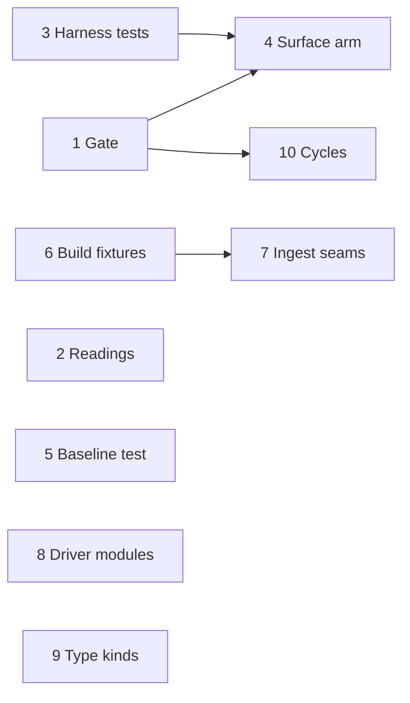

# The simplification plan: the complexity findings, as pull requests

This page is the work [the complexity report](../reports/complexity.md) leaves
open, written as one pull request each and numbered in the order they are worth
landing. The report is findings only — three instruments and the places they
disagree. This page decides, for each finding, which of four things it is: a
test that is missing, a seam that is cut and never crossed, a file that should
not exist, or a decision about what the gate promises. Each section says what it
builds on, the figures that motivate it, the shape the change takes, the
decisions the pull request has to make, and the gate that closes it. A pull
request that lands takes its section with it — the decision moves to an ADR or
the build log — and the numbers of the rest do not change.

The vocabulary is [the deepening plan](arch-review.md)'s: a **module** is
**deep** when a small interface hides a lot of behavior, a **seam** is where the
interface lives, and the **deletion test** — does removing the module
concentrate complexity, or just move it — separates a candidate from a
pass-through.

Every figure below is read from the tree at `c57e94e1` on 19 October 2026, on
the M5, by running the three instruments: `pnpm fta`, `pnpm knip`,
`pnpm knip --cycles` and `pnpm test:coverage`. Nothing else was run except where
a section says so. `pnpm test:gpu --coverage` was **not** run, so every coverage
figure here is the root suite's alone; the render layer reads low for the reason
the report gives, and the report's merged numbers are the ones to compare it
against. The report's own figures date from the tree of 1 September 2026, and
the tree has moved under them — the same globs cover 626 source files against
the report's 354 — so where the two disagree, the figure here is the current
one and the section says what moved. Line numbers drift; the symbol beside each
one is the reference.

---

## Rules every pull request here follows

1. **Tests land before the move, in the same pull request.** The first commits
   pin the current shape; the move is checked by tests that passed before it. A
   refactor whose only evidence is the suite it did not break is not verified,
   it is unobserved.
2. **The seam is the `Host`.** `packages/devtools` already has one — `Host` and
   `RenderHost` in [`harness.ts`](../../packages/devtools/src/harness.ts),
   `openSession` in `session.ts`, and four collaborators built over it:
   `Maneuvers`, `OnFoot`, `CutsceneDirector`, `FlightCamera`. Anything lifted
   out of the harness or the observatory takes `Host`, or a narrower port
   declared beside it, and is tested through `openSession({ workers: null })`
   the way `maneuvers.test.ts` is.
3. **`window.ir` keeps every name it has.** Verbs a console types stay flat on
   the harness; instruments are sub-objects (`ir.cutscene`, `ir.observatory`,
   `ir.onFoot`, `ir.timing`). `scripts/drive.mjs`,
   [`docs/guides/harness.md`](../../docs/guides/harness.md) and `help()` are
   the callers, and nothing in this plan renames a member of `ir`.
4. **I/O at the edge, a pure transform in the middle, a fixture in the tree.**
   The ingest does this once already: `sources.ts` fetches and caches,
   `readHyg` and `buildCatalog` take text and return a `BuildReport`, `main.ts`
   prints and writes. Every other pipeline there takes the same shape, and its
   fixture is a checked-in excerpt small enough to read.
5. **A file nothing imports is deleted.** Coverage cannot see it, fta ranks it,
   and `git log` keeps it. The alternative is naming the screen that mounts it,
   in the same pull request.
6. **A ratchet is installed green and lowered by the change that earns it.**
   `fta:check` and `knip:check` enter `pnpm check` on a tree that passes them.
   The cap is one above the measured worst, which is the report's rule, and the
   pull request that moves the worst file lowers it.
7. **Quote the instrument before and after.** Every pull request body carries
   the `fta` row and the per-file statement, function and branch figures for
   each file it touches, read from `coverage/coverage-final.json`, and the knip
   delta. A figure the body does not quote is a figure nobody measured.

---

## The baseline

### fta

890 files, one over the cap of 91. Code lines, not lines on disk; the report
explains why.

| File                                          | Code lines | Cyclo | Score      |
| --------------------------------------------- | ---------: | ----: | ---------- |
| `packages/devtools/src/observatory.ts`        |      1,812 |   259 | **107.98** |
| `packages/devtools/src/dossier.ts`            |      1,167 |   144 | 90.41      |
| `packages/universe/src/drainage.ts`           |        968 |   156 | 88.64      |
| `packages/devtools/src/harness.ts`            |      1,415 |   100 | 86.83      |
| `packages/universe/src/solar/smallBodies.ts`  |      1,729 |     7 | 86.48      |
| `packages/universe/src/system.ts`             |      1,156 |   107 | 85.42      |
| `scripts/drive.mjs`                           |        821 |   140 | 85.36      |
| `packages/devtools/src/cutscenes/tngIntro.ts` |      1,440 |    59 | 84.52      |
| `apps/game/src/render/terrainKernel.ts`       |      1,952 |    13 | 84.10      |
| `packages/simulation/src/world.ts`            |      1,009 |   118 | 83.89      |
| `apps/game/src/engine/GameEngine.ts`          |        931 |    97 | 80.88      |
| `scripts/docs/api.mjs`                        |        656 |   120 | 80.03      |
| `apps/game/src/tour/executor.ts`              |        759 |   111 | 79.48      |
| `apps/game/src/render/starExtinctionCache.ts` |        747 |   114 | 79.42      |

The report ranked `observatory.ts` fourth, as a 1,130-line class at cyclo 91,
and `harness.ts` third at 1,012 code lines. Both have grown by about forty
percent since, and the observatory is now the one file `pnpm fta:check` fails
on. `drainage.ts` is new to the table; it is the drainage graph of
[ADR-0043](../../docs/adr/0043-the-rivers-drain.md) and is 98.9% covered.

### Coverage

626 source files, 33,414 statements: **66.0% statements, 61.6% functions,
62.9% branches**, root suite only.

| Group                  | Files | At 0% | Statements | Stmt %   | Branch % |
| ---------------------- | ----: | ----: | ---------: | -------- | -------- |
| `apps/game`            |   405 |   126 |     17,574 | 46.3     | 46.5     |
| `packages/universe`    |    49 |     2 |      4,403 | 95.8     | 89.7     |
| `packages/devtools`    |    38 |     3 |      4,017 | **88.2** | **80.1** |
| `packages/rendering`   |    40 |     1 |      2,341 | 97.5     | 91.2     |
| `apps/ingest`          |    13 |     7 |      1,133 | **24.0** | **23.2** |
| `packages/simulation`  |    10 |     2 |        986 | 96.0     | 89.3     |
| `packages/workers`     |    10 |     2 |        573 | 93.7     | 86.6     |
| `apps/server`          |    14 |     1 |        467 | 87.4     | 79.2     |
| `packages/protocol`    |     9 |     1 |        420 | 93.6     | 84.6     |
| `packages/procedural`  |     9 |     1 |        379 | 96.0     | 75.9     |
| `apps/headless`        |     4 |     2 |        278 | 50.0     | 37.7     |
| `packages/spatial`     |     6 |     1 |        250 | 90.8     | 84.0     |
| `packages/physics`     |     5 |     1 |        240 | 97.9     | 92.1     |
| `packages/shared`      |     7 |     2 |        187 | 95.2     | 90.5     |
| `packages/persistence` |     4 |     1 |        117 | 94.0     | 82.5     |
| `packages/net`         |     3 |     1 |         49 | 100.0    | 88.9     |

The "at 0%" column counts a package's `index.ts` in most rows; those are
re-export files with no statements of their own and the count is one for that
reason. `packages/devtools` is the lowest package, and the three files behind
its figure are the three this plan splits or tests.

The files the findings name, with the functions no test enters:

| File                                          | Stmt % | Functions entered | Branch % |
| --------------------------------------------- | -----: | ----------------- | -------: |
| `packages/devtools/src/harness.ts`            |   75.9 | 111 of 153        |     69.5 |
| `packages/devtools/src/observatory.ts`        |   87.4 | 96 of 102         |     80.7 |
| `packages/devtools/src/dossier.ts`            |   95.4 | 50 of 51          |     87.9 |
| `packages/devtools/src/terrainBaseline.ts`    |    5.0 | **0 of 8**        |      0.0 |
| `packages/devtools/src/cutscenes/tngIntro.ts` |   99.4 | 90 of 90          |     89.7 |
| `apps/ingest/src/build.ts`                    |   71.2 | 22 of 27          | **48.2** |
| `apps/ingest/src/shapes.ts`                   |    0.0 | **0 of 27**       |      0.0 |
| `apps/ingest/src/solarReference.ts`           |    0.0 | **0 of 27**       |      0.0 |
| `apps/ingest/src/textures.ts`                 |    0.0 | **0 of 10**       |      0.0 |
| `apps/ingest/src/main.ts`                     |    0.0 | 0 of 35           |      0.0 |
| `apps/ingest/src/galaxyReference.ts`          |   48.0 | 10 of 26          |     55.0 |
| `packages/shared/src/units.ts`                |   94.7 | 17 of 19          |     93.8 |
| `apps/game/src/render/warmup.ts`              |   75.6 | 32 of 44          |     63.2 |
| `apps/headless/src/main.ts`                   |    0.0 | 0 of 8            |      0.0 |

`build.ts` reads 71.2% against the report's 8%: `skyBuild.test.ts` enters
`readHyg`, `buildCatalog` and `buildSkyCatalog` with inline rows. What it does
not enter is `findHost` and four closures inside the identity-resolution steps,
and the branch figure is where that shows.

### knip

`pnpm knip:check` is red on **12** reports in its four classes:

- **4 unused files** — `apps/game/src/components/ui/scroll-area.tsx`,
  `apps/game/src/hud/AddressForm.tsx`, `apps/game/src/hud/NavFailure.tsx`,
  `apps/game/src/hud/ConnectionPip.tsx`. The report's fifth, `tabs.tsx`, is
  imported now.
- **3 unused workspace dependencies** — `@inertialref/physics` in `apps/game`,
  `@inertialref/protocol` and `@inertialref/simulation` in `apps/headless`.
  Confirmed: no file under either `src/` imports them.
- **5 unlisted dependencies** — `Earth`, `Mars`, `Jupiter`, `Saturn` from the
  shadowing `require` at `tngIntro.ts:1594`, and `webgpu` from
  `scripts/gpuAdapter.mjs:26`, which reaches the addon through a
  `createRequire` against `apps/game/package.json` because the root never
  lists it.

Outside those classes: 78 unused exports and 30 unused exported types, 3
duplicate exports (`PANE_ZONES`/`DROP_ZONES`,
`MAX_KERNEL_LEVELS`/`GRIT_FRAMES_AT`,
`MAX_KERNEL_DRAINAGE_NODES`/`DRAINAGE_SEGMENTS_AT`), and **six circular
dependencies** against the report's one: four paths that all close through
`render/warmup.ts → render/sensor.ts`, `universe/drainage.ts ↔ terrain.ts`, and
the `solar/system.ts ↔ system.ts` cycle the report names.

---

## The order

| #   | Pull request                                                                                                                                             | Track    | Builds on |
| --- | -------------------------------------------------------------------------------------------------------------------------------------------------------- | -------- | --------- |
| 1   | [The two instruments gate the tree](#1-the-two-instruments-gate-the-tree)                                                                                | Gate     | —         |
| 2   | [A number is printed by one vocabulary](#2-a-number-is-printed-by-one-vocabulary)                                                                        | Devtools | —         |
| 3   | [Every console verb is entered by a test, and the search is a module](#3-every-console-verb-is-entered-by-a-test-and-the-search-is-a-module)             | Devtools | —         |
| 4   | [The surface arm is a module, and the cap is 91](#4-the-surface-arm-is-a-module-and-the-cap-is-91)                                                       | Devtools | 1, 3      |
| 5   | [The terrain baseline runs in a test](#5-the-terrain-baseline-runs-in-a-test)                                                                            | Devtools | —         |
| 6   | [The catalog build is tested from fixture rows](#6-the-catalog-build-is-tested-from-fixture-rows)                                                        | Ingest   | —         |
| 7   | [The solar reference, the shapes and the textures are fetch → parse → write](#7-the-solar-reference-the-shapes-and-the-textures-are-fetch--parse--write) | Ingest   | 6         |
| 8   | [The driver's steps and its wire are modules](#8-the-drivers-steps-and-its-wire-are-modules)                                                             | Scripts  | —         |
| 9   | [An unrendered type kind fails the docs build](#9-an-unrendered-type-kind-fails-the-docs-build)                                                          | Scripts  | —         |
| 10  | [No module sits on a cycle](#10-no-module-sits-on-a-cycle)                                                                                               | Graph    | 1         |

**Everything but 4, 7 and 10 is independent, and six of the ten are small.**
1 is first because it turns the rest from intentions into checks: after it, a
file past the cap or a file nothing imports fails `pnpm check`, and every later
pull request's gate is a number the runner prints. 4 is the largest and the
only one that must wait: it lowers the cap 1 installs, and it moves code that
3's tests pin. The ingest pair is ordered only by the fixture directory 6
creates. The order across tracks is a suggestion; the order within one is not.

---

## 1. The two instruments gate the tree

**Track:** gate · small · in-process

**Builds on:** nothing. **Unblocks:** every gate below that reads a cap or a
knip count.

**Files.** `knip.jsonc`, `package.json` (`fta:check`), `scripts/check.mjs`
(`STAGES`, `GROUPS.gate`), the four unused files, `apps/game/package.json`,
`apps/headless/package.json`, `tngIntro.ts:1594`, `docs/guides/development.md`.

**The friction.** The report wires both instruments and installs neither,
because each was red: `knip:check` on twelve reports, `fta:check` on nothing at
the time and on the observatory now. A check that exists and is not in
`pnpm check` is advice, and the report's own warning is that a ratchet
installed red teaches `--no-exit-code`.

**The shape.**

- **Delete the four files** (185 lines). `scroll-area.tsx` is shadcn output and
  the CLI rewrites it on demand. The three `hud/` components are hand-written
  and compile, which is why coverage lists them beside the React surface it
  cannot run, indistinguishable from it; the report calls staging ahead of a
  screen a legitimate state to be in and an illegitimate one to stay in.
- **Drop the three dependencies** from the two manifests; `pnpm install`
  rewrites the lockfile.
- **Rename the `require` helper** in `tngIntro.ts` — `stagedBody` says what it
  does and is not a module request to any analyzer. Four call sites, no
  behavior.
- **Tell knip about the addon once more.** The root workspace block in
  `knip.jsonc` gets the `ignoreDependencies: ["webgpu"]` entry `apps/game`
  already carries, with the comment that `gpuAdapter.mjs` resolves it through
  `createRequire` against that app's manifest.
- **Two stages in `check.mjs`,** both in the `gate` group: `knip`
  (`pnpm knip:check`, cost 0.7 s, "a file nothing imports, a dependency nothing
  uses, or an import nothing lists") and `fta` (`pnpm fta:check`, cost 0.1 s,
  "a file past the complexity cap"). The gate group is what the Stop hook runs,
  and 0.8 s against its thirty is the whole cost.
- **The cap is 109**, one above the observatory's 107.98 — the same rule the
  report applied to write 91 when `dossier.ts` was the worst. 4 lowers it to 91.
- **A join over `coverage-final.json`** as `scripts/coverage/files.mjs`, taking
  paths and printing statement, function and branch figures and the names of
  the functions no test enters. The report says the join is a few lines; rule 7
  above asks every pull request to run it, and a script in the tree is how ten
  bodies quote the same arithmetic.

**Decided: the three `hud/` components are deleted.** Nothing in `routes/` or
`hud/` references `AddressForm`, `NavFailure` or `ConnectionPip`, and a
component whose screen does not exist is designed against a guess.

**Decided: `fta:check` enters the gate.** The declarative files are nearest
the line — `smallBodies.ts` at 86.48 grows when a body is added,
`terrainKernel.ts` at 84.10 when a band is — and at 109 both have twenty points
of room, at 91, after 4, five to seven. If a table ever crosses the cap, the
answer is a filename exclusion in `fta.json` with the reason written beside it,
never a higher cap; a table is the one kind of file the score cannot read.

**Gate.** `pnpm knip:check` exits 0. `pnpm fta:check` exits 0 at 109.
`pnpm check --only gate` lists both stages and the group stays under the
thirty-five seconds `.claude/hooks/gate.mjs` quotes. `pnpm knip` reports no
unlisted dependency.

---

## 2. A number is printed by one vocabulary

**Track:** devtools · small · in-process

**Builds on:** nothing. **Unblocks:** nothing; it takes the fourteen formatters
out of the file nearest the cap after the observatory.

**Files.** `packages/devtools/src/dossier.ts` (`:1504–1648`, the Formatting
block), `packages/shared/src/units.ts` (`formatDistance`, `formatReading`,
`formatDuration`, the private `group`),
`packages/universe/src/catalog/designations.ts:183` (`superscript`),
`apps/game/src/planetarium/CameraPanel.tsx:326` and `GroundSection.tsx:238`
(`degrees`), `packages/shared/src/index.ts`.

**The friction.** `dossier.ts` is 1,167 code lines at cyclo 144, 95.4%
covered, and its last 170 lines are a number-and-unit vocabulary that has
nothing to do with dossiers: `group`, `round`, `significant`, `exponential`,
`superscript`, `kilometers`, `period`, `pressurized`, `arcs`, `density` and
`degrees`. Three of them exist twice. `group` is in `units.ts:187` under the
same name with the same regex and the same U+2212 sign, and the comment there
cites `dossier.ts` for the reason. `superscript` is in `designations.ts:183`
over a digit array that lacks the minus. `degrees` is `radiansToDegrees`, which
`units.ts:115` already exports, wrapped in `Math.round` in two planetarium
panels. The one file that imports `units.ts`'s formatters is the one that is
also defining its own.

**The shape.** A module `packages/shared/src/readings.ts` — a number the way an
instrument prints it. It takes the dossier's eleven, and it takes
`formatDistance`, `formatReading` and `formatDuration` from `units.ts` with
them, because `formatReading` needs `group` and `period` needs
`SECONDS_PER_YEAR`: left where they are, `units.ts` and `readings.ts` import
each other. `units.ts` keeps the types, the constants and the conversions and
imports nothing from `readings.ts`; `index.ts` re-exports both, so no caller
outside `packages/shared` changes an import. `dossier.ts` imports eleven names
and keeps the nine `*Group` builders, the classifiers and the five `*Word`
functions — `colorWord`, `albedoWord`, `eccentricityWord`, `tiltWord`,
`opacityWord` are the dossier's prose and stay. `designations.ts` imports
`superscript`. The two panels write `Math.round(radiansToDegrees(x))` and lose
their local copies.

`period` and `formatDuration` are two ladders over seconds and stay two. They
break at different rungs — `period` at two years, two days, two hours and two
minutes with decimals by band, `formatDuration` at one of each with two
decimals — and the difference is a reading: Mars's year is **686.98 d** in an
almanac, and `formatDuration` prints it **1.88 yr**. Both land in `readings.ts`
with a comment naming the surface each one serves and that example.

**Tests.** `readings.test.ts`, which takes the dossier's "the readings"
describe and `units.test.ts`'s `formatDistance` cases. Properties:

- `group` is the identity on digits — strip the commas and the U+2212 and the
  input comes back.
- `exponential` never prints `e`, `+` or a hyphen.
- The ladders are monotone: for `kilometers` and `period`, a larger magnitude
  never chooses a smaller unit.
- **Every formatter prints the em dash alone for a non-finite input.** This one
  fails today, and that is what it is for: `arcs(NaN)` prints `—″` and
  `pressurized(Infinity)` prints `— bar`, because their non-finite guard sits
  inside `round` and `significant` and the unit is appended after. Fixing it
  is two early returns, and the property is what stops a twelfth formatter
  doing the same.
- Goldens: Earth `6,371 km`, Mars `686.98 d` beside `1.88 yr`, the Sun from
  Earth `0.533°`, and the arcminute and arcsecond rungs.

**Gate.** `dossier.ts`'s cyclo and score drop in the fta row the body quotes.
`dossier.test.ts` unchanged and green. `pnpm knip` lists no duplicate between
`units.ts` and `readings.ts`. `rg 'const (degrees|superscript|group) ='` over
`apps` and `packages` finds only `readings.ts`.

---

## 3. Every console verb is entered by a test, and the search is a module

**Track:** devtools · medium · in-process

**Builds on:** nothing. **Unblocks:** 4, whose move these tests pin.

**Files.** `packages/devtools/src/harness.ts`, a new `harness.test.ts`, a new
`host.ts`, `session.ts`, `docs/guides/harness.md`.

**The friction.** `harness.ts` is 1,415 code lines at cyclo 100 and 75.9%
covered, with **42 of 153 functions never entered** and 69.5% of branches.
The report's list of uncovered verbs is stale in the right direction —
`pause`, `resume`, `timeWarp`, `hold`, `control`, `flightAssist`, `logs`,
`systemsNearby`, `aim` and `burnToward` are all entered now — and what is left
is still the console surface:

- **presentation** — `picture`, `shots`, `trackOverlay`, `trackOverlayShowing`,
  `target`, `chrome`, `layers`, `presets`
- **measurement** — `terrainCache`, `clearTerrainCache`, `zoo`,
  `terrainBaseline`, `timing`, `gpu`, `passes`, `settled`
- **transport and state** — `runSeconds`, `throttle`, `snapshot`
- **structures** — `placeStructure`, `removeStructure`, `visitStructure`
- `help`, and the eight default closures of `renderHost()` (`:442–467`), two
  inside `findWorlds` (`:930`, `:945`) and two inside `scenario`.

Most are one-line forwards to the host and the rig checks them by hand in
Chrome, which is real and reports no coverage. The file also holds the one
verb that is a module in all but name: `findWorlds` (`:845–979`) is 134 lines
over the world, the catalog and an options record, beside `search`, `rowsFor`,
`searchEntries`, `searchIndexVersion` and `targets`, which already lean on
`travel.ts`.

**The shape.**

- **`host.ts`** takes `Host`, `RenderHost`, `renderHost()`, `BootPhase`,
  `FrameStats` and the terrain-cache and guide status types out of
  `harness.ts`. Six files — `observatory.ts`, `maneuvers.ts`, `onFoot.ts`,
  `cutscene.ts`, `flightCamera.ts` and `dossier.ts` — import `type Host` from
  the harness they are composed into, so every collaborator names the thing
  that composes it to get its own port. The move is erased at runtime and is
  only a name, but it is the name that lets 4's module import its port without
  importing the harness.
- **`harness.test.ts`**, new rather than another describe in the 870-line
  `devtools.test.ts`, through `openSession({ workers: null, render })` with a
  `render` override that records `setChrome`, `setLayers`, `declareCut` and
  answers `terrain()`, `measureGpu` and `measurePasses` — `renderHost(overrides)`
  exists for exactly this. One `it` per verb above; `gpu()` and `passes()` are
  tested both ways, null host and answering host, because the null branch is
  the one the rig never sees.
- **`help()` is checked against the class.** Every `ir.<name>` the string
  names must be an own property of `GameHarness.prototype`, a field set in the
  constructor, or a member of a named sub-object. The string is hand-written
  and a renamed verb leaves it wrong silently; the test makes that a red line
  with the name in it.
- **`findWorlds` and the search group leave the file**, as `finding.ts` beside
  `travel.ts`: functions over `(world, catalog, here, options)` the harness
  forwards to, tested directly with `TEST_CATALOG` the way `maneuvers.test.ts`
  tests flight. The two uncovered closures at `:930` and `:945` are branches of
  the options; the direct test reaches them.

**Decided: the search leaves.** `findWorlds` has no harness state in it and
the harness's forward is one line. If the walk finds otherwise, the tests land
and the move does not.

**Gate.** Every verb in `help()` is entered by a Node test: `harness.ts`
functions entered rise from 111 of 153 to the count the body quotes, with the
named ones at zero remaining. The fta row for `harness.ts` drops by the search
group's size. `devtools.test.ts`, `observatory.test.ts` and
`marsLanding.test.ts` unchanged and green. `docs/guides/harness.md` § "Finding
and loading destinations" cites `finding.ts`.

---

## 4. The surface arm is a module, and the cap is 91

**Track:** devtools · large · in-process, with a browser acceptance

**Builds on:** 1 for the cap, 3 for the tests and `host.ts`. **Unblocks:**
nothing; it is the one pull request that takes the tree back under the
report's cap.

**Files.** `packages/devtools/src/observatory.ts`, new `surfaceArm.ts`,
`stanceGeometry.ts` and `heldTime.ts`, their tests, `observatory.test.ts`,
`package.json` (`fta:check`), `docs/guides/harness.md` § "Standing on a body".

**The friction.** `observatory.ts` is **1,812 code lines at cyclo 259, scoring
107.98** — the only file over the cap, and the report's "the thing fta exists
to point at" at a size forty percent past the one it pointed at. It is one
class from `:370` to `:2776`, 87.4% covered, with six functions never entered:
`look`, `turn`, `center`, `levelToHorizon`, `sites`, `stanceBounds`. The arms
are visible in the member list:

| Arm                 |  Lines (on disk) | What it owns                                                                                                                                                                                                                                                                                                                   |
| ------------------- | ---------------: | ------------------------------------------------------------------------------------------------------------------------------------------------------------------------------------------------------------------------------------------------------------------------------------------------------------------------------ |
| Finite motion       |       `:370–480` | `startMotion`, `stopMotion`, `#advanceMotion`, `hold`; tested in `observatoryMotion.test.ts`                                                                                                                                                                                                                                   |
| Held time           |       `:482–526` | `#time`, `#timePaused`, `#timeScale` and six accessors with two bounds                                                                                                                                                                                                                                                         |
| Pictures            |       `:527–622` | `capture`, `validatePicture`, `restore`                                                                                                                                                                                                                                                                                        |
| Tracking            |       `:623–727` | `track`, `framePair`, `#pair`, `#trackingTransform`, `#orbitPose`                                                                                                                                                                                                                                                              |
| Galaxy              |       `:728–851` | `travelGalaxy`, `holdGalaxyJourney`, `viewGalaxy`, `#advanceJourney`; tested in `galaxyJourney.test.ts` and `galaxyView.test.ts`                                                                                                                                                                                               |
| Orbit and look      |      `:852–1474` | `focus`, `clear`, `drag`, `zoom`, `setDistance`, `setAngles`, `frameTarget`, `look`, `turn`, `setLook`, `center`, `setPhase`, `orbitPhase`, `bounds`, `compose`, `rise`                                                                                                                                                        |
| **Surface**         | **`:1565–2400`** | `stand`, `setStanceFlight`, `#advanceFlight`, `leaveSurface`, `drop`, `groundUnderRay`, `previewDrop`, `previewLaunch`, `entryArcPreview`, `#holdRing`, `#groundRing`, `#descentStance`, `#advanceDescent`, `moveTo`, `setStanceHeight`, `setStanceScrub`, `setHeading`, `setPitch`, `levelToHorizon`, `sites`, `stanceBounds` |
| Status and sampling |     `:2401–2776` | `status`, `sample`, `#arrived`, `#surfacePose`, `#surfaceStatus`, `#resolve`                                                                                                                                                                                                                                                   |

The surface arm is about 830 lines on disk, owns five fields of its own
(`#stance`, `#site`, `#flight`, `#descent`, `#aim`), and is entered from the
rest of the class at exactly the points `sample` and `status` ask whether a
stance is held. The six unentered functions are in it or in the look arm.

**The shape.** Three lifts, smallest first, each tested before the next.

- **`heldTime.ts`** — the photographic instant as a value object: `time`,
  `heldTime`, `paused`, `scale`, `set`, `advance`, with the two bounds the
  class enforces (a scale in `(0, 100000]`; an instant within ±3.15576e12 s,
  which is 100,000 years of J2000). Forty-five lines, pure, and the bounds are
  properties: `advance` past the limit pauses rather than overflows, and
  `set(null)` releases to the host's `renderTime`.
- **`stanceGeometry.ts`** — the pure arithmetic of the surface arm as
  functions of a body, a direction and an eye in the body's rotating axes:
  `holdRing` (`:2067`), `groundRing` (`:2107`), the body of `entryArcPreview`
  (`:1939`) from `local` down, the lat/lon step of `#advanceFlight` (`:1684`)
  and `#descentStance` (`:2201`). Each takes what the method reads from
  `this` as a parameter and returns what it returned. Properties, with
  `fast-check` over directions and eyes:
  - every hold-ring point lies in the plane perpendicular to the line of
    sight through `at`, at `range × HOLD_ANGLE` from it;
  - every ground-ring point sits exactly `across × RING_LIFT_SHARE` above
    `drawnSurfaceRadius` along its own direction — the ring is on the ground,
    which is the property the comment at `:2102` claims;
  - a flight step keeps `|latitude| ≤ π/2` and wraps longitude into
    `(−π, π]`, and the distance covered per second is `max(FLIGHT_FLOOR_SPEED,
height × FLIGHT_SPEED_PER_HEIGHT)`, times `FLIGHT_FAST` when asked;
  - the descent stance at progress 0 is the release and at 1 is the touchdown.
- **`surfaceArm.ts`** — a `SurfaceArm` owning the five fields and the verbs in
  the table, built over `Host` and a port the observatory implements beside
  it: `target()`, `resolve(address)`, `focus(address)`, `orbitEye()`,
  `changed()`. `Observatory` keeps a `#surface: SurfaceArm`, forwards the
  verbs, and asks it `pose()` and `status()` where `#sample` and `status` ask
  `#stance !== null` today. The `declareCut()` calls stay where they are made,
  for the reason the deepening plan's "What the landed deepenings left" gives
  for the director's.

The galaxy journey (`:728–851`, 120 lines, tested) is the second lift if the
arm alone leaves the file over 91; a module of its own is already the shape
`galaxyJourney.test.ts` tests it in.

**Decided: `stanceGeometry.ts` lives in `packages/devtools`.**
`packages/rendering` is arithmetic and would take it, but
`apps/game/src/planetarium/entryAid.ts` draws these figures through the
harness, so there is one caller. It is promoted when a second appears.

**Decided: the six unentered functions are tested, not deleted.** `look`,
`turn` and `center` are the look arm's console verbs; `levelToHorizon`, `sites`
and `stanceBounds` the stance's. `ir.sites` and `ir.aim` reach them from the
rig, and 3's `harness.test.ts` enters them before the lift — which is why 3
comes first.

**Gate.** `observatory.ts` under 91, and `fta:check` lowered to 91 in the same
change. Every function in the three files entered. `observatory.test.ts`,
`observatoryMotion.test.ts`, `galaxyJourney.test.ts` and `galaxyView.test.ts`
unchanged and green — they are the pin. `pictureLedger.test.ts` unchanged: the
thirteen pictures' positions, lenses, altitudes and the world's state hash,
which is rule 37 executed over a camera refactor. `pnpm presets:compare` over
the lit pictures within the noise floor the
[regression rig](../../docs/guides/testing.md#the-pictures-are-a-fixture) names,
at least one of them a stance on a generated body outside Sol, named in the
pull request.

---

## 5. The terrain baseline runs in a test

**Track:** devtools · small · in-process

**Builds on:** nothing.

**Files.** `packages/devtools/src/terrainBaseline.ts`, a new
`terrainBaseline.test.ts`.

**The friction.** 236 code lines, cyclo 15, **0 of 8 functions entered**, 5.0%
of statements — the one uncovered file in `packages/*`, and the report's "thin
uncovered layer over a tested one": `descent.ts` and `terrainZoo.ts`, which it
calls, are covered, and `terrainRig.test.ts` sits beside it exercising
`simulateDescent` directly. `apps/headless/src/main.ts` is the only caller and
is itself at 0%.

**The shape.** No change to the module. The file is already written to be
tested: `now` is a parameter, and with `now === null` the whole pass is
deterministic and generates nothing — the header says a descent without
generation is a few hundred noise samples. Two tests:

- `terrainBaseline(world, null, { lightYears, systemBudget })` on
  `openSession({ workers: null })` with the zoo narrowed by `ZooOptions`:
  `timed` is false, `missing` is empty (the zoo's own contract — "Empty is the
  only passing answer"), every entry has every survey site flown with
  `finalLevel` and `floorLevel` populated, `baselineAddresses` equals the zoo's
  addresses, and `summarizeBaseline` contains `not timed — the host supplied no
clock` and no `SHORT OF THE FLOOR`.
- The timed path with a counting `now` and `timedPatches: 1`, so the warm-up's
  twelve patches are the cost; and `steps` short enough that the descent asks
  for fewer regions than the warm-up discards, which is the other
  `summarizeBaseline` branch — `not timed — the descent asked for too few
patches` — and is the branch the header calls the one number worse than
  none.
- `terrainBaselineWithSource` through `createInlineWorker` and
  `createTaskRegistry`, the way `terrainRig.test.ts` builds a source.

**Gate.** 8 of 8 functions, both `summarizeBaseline` branches entered,
`terrainBaseline.ts` above 90% statements. The file runs under the 20 s
timeout with its reason stated at the call site if the warm-up needs one.

---

## 6. The catalog build is tested from fixture rows

**Track:** ingest · small · in-process

**Builds on:** nothing. **Unblocks:** 7, which uses the fixture directory.

**Files.** `apps/ingest/src/build.ts`, a new `apps/ingest/fixtures/`, a new
`build.test.ts`.

**The friction.** `build.ts` is the sharp file in the ingest, and an entered
one: 71.2% of statements, 22 of 27 functions — and **48.2% of branches**, over code whose job is deciding which of 119,614 rows to keep. The
header names the two steps where an ingest goes quietly wrong, _resolve
identity_ and _merge planets_; `findHost` (`:725`) is never entered and the
four unentered closures are inside `packSystems`, `buildCatalog`,
`buildSkyCatalog` and the merge. `skyBuild.test.ts` builds its rows inline and
asks about the sky selection; nothing asks about the `BuildReport` counts the
header says the caller prints because they are where it goes wrong.

**The shape.** A hand-written HYG excerpt of a dozen rows and an exoplanet
excerpt of as many, under `apps/ingest/fixtures/`, chosen to exercise each
identity path once: a host matched by HIP, by HD, by name, one resolved by
`separationArcsec` against two candidates, a planet whose host is absent, a
duplicate designation, a row with a missing column. `build.test.ts` runs
`readHyg` → `buildCatalog` and asserts **every counter in `BuildReport`
exactly** — the counts are the interface, and an off-by-one in a count is the
whole bug. One property: `readHyg` over tables generated through `csv.ts`
returns one row per data line.

Fixtures live outside `src/` so `knip.jsonc`'s `project` globs do not read
them and vitest's `include` (`apps/*/src/**/*.test.ts`) keeps the tests beside
the code; the tests read `../fixtures/`.

**Gate.** `build.ts` at 27 of 27 functions and above 85% of branches, every
`BuildReport` field asserted at least once, `ingest.test.ts` and
`skyBuild.test.ts` unchanged.

---

## 7. The solar reference, the shapes and the textures are fetch → parse → write

**Track:** ingest · medium · in-process

**Builds on:** 6 for the fixture directory.

**Files.** `apps/ingest/src/solarReference.ts`, `shapes.ts`, `textures.ts`,
new `solarRecords.ts` and `shapeResample.ts`, their tests, fixture excerpts,
`.claude/rules/catalog.md` (the ±6% bullet gains its test's name).

**The friction.** Three files at **0 of 64 functions**, each exporting one
async entry that fetches, parses, transforms and writes. The report's finding
2 is intact: `tableRows` and `firstNumber` are exported pure parsers that
nothing imports — knip still lists them — and the seam they were cut for has
never been crossed. In `shapes.ts` the whole mesh pipeline is already
module-private pure functions: `readGrid`, `readObj`, `readVertexTable`,
`volumeAndCentroid`, `center`, `rayTriangle`, `resampleMesh`, `resampleGrid`,
`fillGaps`, `interval`, `wrapping` — `:97–562`, two thirds of the file and most
of its cyclo 80. `textures.ts`'s `elevationToNormal`, `luminanceToAlpha` and `plainImage`
take `sharp` images, and `textures.test.ts` imports `sharp` already — to check
the committed night texture, not the functions that made it.

knip lists seventeen unused exports and types in the ingest. Ten are these
three files' and their source tables' — `tableRows`, `firstNumber`,
`PlanetRecord`, `SatelliteRecord`, `SmallBodyRecord`, `SolarSourceKind`,
`ShapeEntry`, `ShapeFormat`, `TextureEntry`, `License` — and every one is a
door for a test that was never written. Six are `galaxyReference.ts`'s and one
is `rawDirectory`.

**The shape.** The pattern `sources.ts` / `readHyg` / `main.ts` already
sets, applied three times.

- **`solarRecords.ts`** holds `PlanetRecord`, `SatelliteRecord`,
  `SmallBodyRecord`, `tableRows`, `firstNumber`, `parsePlanetTable`,
  `parseSatellites`, `parseSmallBody` and a `solarReference(texts)` that takes
  the fetched texts by source id and returns the `SolarReference`.
  `solarReference.ts` keeps `fetchText`, the digest and `buildSolarReference`,
  which becomes fetch → `solarReference` → write. The fixtures are excerpts of
  the three JPL tables `solarSources.ts` names — planetary physical
  parameters, satellite physical parameters, satellite mean elements — and one
  SBDB response, each a few rows in the real markup. The test parses them and holds the
  records equal to the matching entries of the committed
  `data/reference/solar-system.json`, so the fixture is anchored to the data
  the game ships rather than to what the test's author believed. `required`'s
  throw and `validateSource` get the example tests testing.md reserves for a
  refusal.
- **`shapeResample.ts`** holds the mesh pipeline and a `shapeFieldFrom(text,
source)` returning the field and the volume ratio; `shapes.ts` keeps
  `download`, the manifest and `buildShapes` as fetch → `shapeFieldFrom` →
  `encodeShapeField` → write. Tests generate their meshes:
  - a UV sphere of radius `r` as a vertex table resamples to a field within a
    named bound of `r` everywhere and a volume ratio of 1 within the grid's
    own quantization;
  - an ellipsoid's `shapeExtent` recovers its three half-extents to the same
    bound;
  - **a torus is refused.** A radius grid is single-valued per direction, so
    a body that is not star-shaped cannot be held, and
    `.claude/rules/catalog.md` says never widen the ±6% tolerance to make one
    fit. The test is that rule made executable, and the rule's bullet names
    the test.
  - a round trip through `decodeShapeField` and `sampleShapeField` from
    `@inertialref/rendering`, which is the reader the game uses;
  - a `fast-check` property over smooth star-shaped radial functions sampled
    onto a vertex table: the volume ratio stays inside the tolerance.
- **`textures.ts`**: the three transforms tested on 8×8 images `sharp` makes
  in the test — a flat elevation gives the normal `(0.5, 0.5, 1)` everywhere,
  a linear ramp gives one constant tilt, and `luminanceToAlpha` of a known
  gray gives that alpha. `buildTexture` stays the I/O shell.
- **`galaxyReference.ts`** (48%, 10 of 26) is the same shape with half its
  test written: `galaxyReference.test.ts` reaches `extractSky` and
  `readDustCube` against the generated tables, and `extractClouds` and
  `buildGalaxyReference` — the two exports knip lists as unused — are the half
  it does not. They take the same treatment, in this pull request or the next
  one that opens the file.

`main.ts` (0 of 35) is the command-line shell and stays untested as one; its
three `*License` builders are pure strings and are not worth a file.

**Decided: fixture excerpts land in the tree.** Under 20 KB each, with a
comment naming the source URL and the date it was cut. Asserting only the
committed output's shape, as `textures.test.ts` does, proves the writer ran
once, not that the parser decides anything.

**Gate.** `solarRecords.ts` and `shapeResample.ts` above 85% of statements
with every parser entered; the fta rows for `shapes.ts` and
`solarReference.ts` drop by the lifted half; knip lists none of those ten as
unused; `data/reference/solar-system.json`,
`data/shapes/*.irsm` and `data/textures/` **unchanged** — this pull request
moves code and writes no data.

---

## 8. The driver's steps and its wire are modules

**Track:** scripts · medium · in-process, with one real invocation

**Builds on:** nothing.

**Files.** `scripts/drive.mjs`, new `scripts/driveSteps.mjs` and
`scripts/cdp.mjs` with tests, `docs/guides/harness.md` § "Driving from an
automated browser session", the `drive` skill.

**The friction.** `drive.mjs` is 821 code lines at **cyclo 140**, the highest
in the repository after `observatory.ts` and `drainage.ts`, and it is the one
sanctioned path for every browser session an agent runs. Two pieces are
already out and tested — `driveUrl.mjs` (163 lines of test) and
`driveScript.mjs` — and what is left is three things in one file: the session
(`serve`, `launchChrome`, `pageTarget`, `boot`, the state file), the wire
(`connect` at `:470`, `evaluate`, `clearStorage`, `castFrames`, `traceFor`),
and `main()` from `:977`, which is a 130-line `switch` over the ten steps
with the `settle` algorithm written inline at `:1053–1081`. That algorithm —
two quiet reads in a row, a budget, a report that says what was still
arriving — is the thing a plate's correctness rests on, and nothing can test it
without Chrome.

**The shape.**

- **`driveSteps.mjs`** — `planSteps(tokens)` turns `parseArgs`'s token list
  into the ordered step list `:307` builds today, and `runSteps(script, rig)`
  is the `switch`, over a `rig` of `{ evaluate, sleep, now, capture, cast,
trace, sample, logs, reboot, say }`. The settle rule becomes a function of
  a sequence of `ir.settled()` answers and a clock. Tests: a plan preserves
  interleaving (`--js a --wait 1 --js b` is three steps in that order, which
  the comment at `:299` says is the whole point); settle converges on the
  first two consecutive `ok` and not on one; settle reports `settled: false`
  and the last report when the budget runs out; every step pushes one result;
  `--json` is the results and the trailing errors.
- **`cdp.mjs`** — `connect(ws)` and `evaluate(send, expression, userGesture)`
  over a fake `WebSocket`: a reply is matched to its id, an `exceptionDetails`
  rejects with the message, events fan out to `subscribe`, and a close mid-call
  rejects the pending calls rather than hanging them.
- **`boot()` takes `send`** already; its readiness ladder — `drawing`, `booted`,
  document mode, the twelve-second give-up — gets a test with a scripted
  `send`. The deepening plan's open item that the driver cannot tell a reload
  from the page it left lives in that ladder, and this is what makes it
  testable.
- `drive.mjs` keeps `OPTIONS`, `HELP`, the state file, Chrome and the dev
  server, and a `main()` that wires them.

**Gate.** `driveSteps.test.mjs` and `cdp.test.mjs` in `pnpm test` — the
`scripts/**/*.test.mjs` glob collects them. `drive.mjs` under half its cyclo,
with the body quoting the three rows. `node scripts/drive.mjs --help` is
byte-identical. One real invocation in the pull request, exercising every step
kind the moved `switch` dispatches — `--preset earthrise --js "ir.status()"
--settle 8000 --shot earthrise.jpg --cast 30 --logs`, then `--down` — with the
still and the cast report attached. The compare rig has a driver of its own
and is not evidence here.

---

## 9. An unrendered type kind fails the docs build

**Track:** scripts · small · in-process

**Builds on:** nothing.

**Files.** `scripts/docs/api.mjs`, `scripts/docs/api.test.mjs`.

**The friction.** 656 code lines at cyclo 120, and the cyclo is honest about
its shape: `typeHtml` (`:571`) is a `switch` over TypeDoc's type kinds,
`declarationHtml`, `signatureHtml` and `commentHtml` are the same over
reflection and comment kinds. A flat switch of nineteen cases is cyclo nineteen
and is not hard to read. What is wrong with it is the default: a kind the
switch does not know renders as `unknown`, silently, into the published
reference — a page that is wrong in the one way a reader cannot tell from
right. The build's own rule, from `wings.mjs`, is to refuse rather than guess.
`api.test.mjs` tests routes and links with an inline reflection; it has one
`intrinsic` and one `reference` type in it.

**The shape.** `typeHtml` becomes a table keyed by `type.type`, and the
missing-key case throws with the kind and the owning symbol's name, so
`pnpm docs:build` — and with it `pnpm check` and CI — fails on a TypeDoc
upgrade that introduces a kind rather than publishing `unknown`. `api.test.mjs`
gains one member per kind in its inline project and an `it.each` golden over
the HTML of each, plus the throw.

**Gate.** Every key of the table has a golden; the throw has a test;
`pnpm docs:build` green on the current tree, which proves the current
reference uses no kind the table lacks.

---

## 10. No module sits on a cycle

**Track:** graph · medium · in-process, with the GPU suite for the render move

**Builds on:** 1 for `knip.jsonc`.

**Files.** `packages/universe/src/system.ts`, `solar/system.ts`, new
`versions.ts`; `drainage.ts`, `terrain.ts`, new `regions.ts`;
`apps/game/src/render/sensor.ts`, `warmup.ts`, new `sceneTarget.ts`;
`apps/game/src/dock/layout.ts`; `knip.jsonc`; `package.json` (`knip:check`);
`apps/headless/src/moduleGraph.test.ts`.

**The friction.** knip reports six circular dependencies and three are
distinct:

- **`solar/system.ts ↔ system.ts`.** The report's one. `solar/system.ts:27–34`
  imports five types and one value, `GENERATION_VERSIONS`; `system.ts:59`
  imports `SOL` and `solarSystem`. The value is the runtime edge, and the
  types are too: under `verbatimModuleSyntax` an inline `type` specifier keeps
  `import {} from '../system.ts'` as a side-effect import, so the edge survives
  until the statement is `import type`. `moduleGraph.test.ts` exists because
  this cycle once threw a TDZ `ReferenceError` on `import('system.ts')`, and it
  holds the cycle _safe_ by spawning Node per entry point; it does not remove
  it.
- **`drainage.ts ↔ terrain.ts`.** `drainage.ts:23–31` imports the region
  lattice — `regionForDirection`, `regionDirection`, `regionNeighbor`
  (`terrain.ts:151–240`) — and three datums — `drainageDatum`, `coastWidth`,
  `seaDatumElevation`; `terrain.ts:38–43` imports `carveDrainage`,
  `drainageGraph`, `drainageLookup`, `drains`. Both already import
  `sketch.ts`, which is the leaf they want.
- **`warmup.ts → sensor.ts`, four paths.** All four start at `warmup.ts:17`,
  `import { warmTargetFor } from './sensor.ts'`, and `sensor.ts:50` imports
  `warmPipeline` back. `warmTargetFor` (`sensor.ts:116`) is the 4×4 stand-in
  target cache — `standIns`, `shapeKey`, `sceneTarget` at `:91–150` — over
  `sceneLayout.ts`, and nothing else in the sensor.

`pnpm graph` cannot see any of these: it polices layering _between_ packages
and discards every intra-package edge first. And two of the three duplicate
exports are not duplicates: `GRIT_FRAMES_AT` and `DRAINAGE_SEGMENTS_AT` are
layout offsets whose value coincides with a count because the earlier records
come first, and the offset's name is the fact a reader of the kernel layout
needs. `DROP_ZONES` is the third, and knip lists it as unused.

**The shape.**

- **`versions.ts`** takes `SYSTEM_ALGORITHM`, `TERRAIN_ALGORITHM`,
  `GALAXY_ALGORITHM`, `PHOTOMETRY_ALGORITHM` and `GENERATION_VERSIONS` from
  `system.ts` (`GALAXY_FIELD_ALGORITHM` stays in `galaxy/field.ts`, which the
  leaf imports). `solar/system.ts`'s remaining import from `system.ts` becomes
  `import type`. `moduleGraph.test.ts` keeps its six spawns and gains
  `versions.ts`: it is the fix, and an edit that gives the leaf an import is
  how the cycle comes back, which is the sentence the test already says about
  `rounding.ts`.
- **`regions.ts`** takes the lattice and the three datums out of `terrain.ts`;
  both files import it. If a datum reads something of `terrain.ts`'s own, that
  something moves with it or the datum stays and the cycle is reported as
  still open, in the body.
- **`render/sceneTarget.ts`** takes `standIns`, `shapeKey`, `sceneTarget` and
  `warmTargetFor`; `sensor.ts` and `warmup.ts` import it. A render move, so
  the GPU suite is the gate.
- **`DROP_ZONES` is deleted.** The two offsets keep their names and gain one
  comment line each saying they are offsets, not aliases.
- **The gate.** `knip.jsonc` gains `"rules": { "cycles": "error" }` and
  `knip:check` includes `cycles`. The config's "no rules" stance holds for
  every other type: `cycles` is reported as a warning by default and the rule
  only changes its exit code, and `pnpm knip` carries `--no-exit-code`, so the
  report is unchanged. The rule is proved the way testing.md asks a regression
  test to be: reintroduce one cycle in a scratchpad copy and watch
  `knip:check` exit 1 before keeping it.

**Decided: `moduleGraph.test.ts` adds `versions.ts` only.** Its header says
six spawns is the deliberate count and a seventh "would cost a second and catch
nothing". Once the cycle is gone, knip's gate is the catch, and the spawn test
is the TDZ proof for the one cycle that bit.

**Gate.** `pnpm knip --cycles` reads `Circular dependencies (0)`;
`pnpm knip:check` exits 0 with `cycles` included; `moduleGraph.test.ts`
green; `pnpm test:gpu` over `warmup.gpu`, `sensor.gpu` and `upscale.gpu`
green; `drainage.test.ts` and the seven other tests that import `terrain.ts` —
`universe`, `geology`, `scatter`, `micro`, `cover`, `surveySites`,
`terrainKernel` — unchanged; `pnpm knip` lists two duplicate exports, each with
its comment.

---

## Measured, not acted on

Files the current ranking puts near the top that the report did not name, and
the question a walk of each would answer. None is a pull request here, because
each is covered and none has been read for this page beyond its row.

- **`packages/universe/src/drainage.ts`** — 968 code lines, cyclo 156, 88.64,
  98.9% covered. One algorithm with its citations, under
  [ADR-0043](../../docs/adr/0043-the-rivers-drain.md) and the
  [erosion plan](erosion.md). The question is whether the graph build and the
  carve are two modules or one; the coverage says the tests already answer
  for both.
- **`packages/simulation/src/world.ts`** — 1,009 lines, cyclo 118, 83.89, 96%
  covered. The deepening plan judged its verbs deep (`EntityView`, "a
  whole-store write verb" settled). The question is the size, not the shape.
- **`apps/game/src/engine/GameEngine.ts`** — 931 lines, cyclo 97, 80.88; the
  report put it at 75% without the descent suite, and the slow suite now runs
  through worker threads ([test speed § 2](test-speed.md#2-a-real-worker-pool-in-the-test)),
  so the merged figure is measurable now and is not measured here.
- **`apps/game/src/tour/executor.ts` and `runtime.ts`** — cyclo 111 and 110
  over 759 and 624 lines. The guide's tool loop, which
  [the deepening plan](arch-review.md#judged-deep-and-left-alone) found
  testable without a provider. The question is whether the two files are the
  loop and its host or one loop in two places.
- **`apps/game/src/render/starExtinctionCache.ts`** — cyclo 114 over 747
  lines, a cache with a CPU and a GPU batch path; its figure lives in the GPU
  suite this page did not run.
- **`packages/universe/src/system.ts`** — cyclo 107, 92% covered, with
  `massFromPlanetRadius` and `primaryMoon` never entered. The report's data
  tables are beside it; the generator is not one.

Two more things the instruments showed and this plan leaves where they are:

- **The 78 unused exports.** The report is right that most are the cost of
  testing a module through its constants — `FOV_MIN`/`FOV_MAX`,
  `SHUTTER_MIN`/`SHUTTER_MAX` and their eight neighbors in `hud/controls.ts`.
  A behavior test (the control clamps) would let each pair stop being
  exported; that is a style to adopt the next time one of those tests is
  opened, not a pull request. `exports` stays a warning.
- **The non-React zeros in `apps/game`.** `render/preload.ts` (0 of 18),
  `render/shapeModels.ts` (0 of 13), `dock/useWorkspace.ts` (3.8%) and
  `apps/headless/src/main.ts` (0 of 8) are not the React surface and are
  still at zero. The first two construct Three objects and belong to the GPU
  suite if anywhere; the hook is React; the headless `main.ts` is a
  command-line shell whose verbs 5 reaches from below. Named so the figure is
  not read as the invariant's cost when it is not.

---

## Settled, not reopened

- **The data tables.** `smallBodies.ts` (86.48, cyclo 7), `solar/bodies.ts`
  (79.03, cyclo 3), `render/terrainKernel.ts` (84.10, cyclo 13) and
  `cutscenes/tngIntro.ts` (84.52, cyclo 59, 99.4% covered). Read the score as
  "this file is long", which is true and fine; the report's "fta cannot tell a
  table from a thicket" is the whole argument.
- **The React surface.** 126 files in `apps/game` at 0%, most of them `.tsx`,
  because every test runs in plain Node on purpose. The invariant is worth its
  46.3%, and `vitest.config.ts`'s header is where the reason lives.
- **Comment density.** fta ignores comments; the house style costs nothing in
  any score here.
- **`exports` as a warning, not an error.** `knip.jsonc` carries the reason.

---

## Instrument notes

What running the three for this page taught, beyond the numbers.

- **The coverage instrument has a second casualty.** The report names the
  descent suite, which the slow project now holds. In both instrumented runs
  for this page `geology.test.ts`'s "has no step in it, anywhere a crater rim
  falls" exceeded the 20 s timeout and failed the run; alone and
  uninstrumented it takes 2.5 s. The v8 provider costs about a third on the
  whole suite and a great deal more on a test that is one tight loop over a
  field. `--coverage.reportOnFailure=true` is how the report is still written
  when it happens. Whether that test states an instrumented budget at its call
  site is a decision for whoever next opens it; testing.md's rule is to
  investigate before raising a timeout, and this is a diagnosis, not a raise.
- **The denominator moves with the tree.** 626 files under the same globs that
  covered 354 seven weeks ago. A percentage quoted without its file count is a
  figure about nothing, which is the report's point about denominators, made
  again by time.
- **knip's cycle gate is a rule, not a flag.** `--include cycles` reports
  them; only `rules.cycles: "error"` fails on them. Documented at
  [knip.dev](https://knip.dev/features/rules-and-filters) and the reason 10
  touches the config rather than the script.
- **Vitest scopes thresholds per glob**, and does not inherit the global ones
  into a glob's block. A `packages/*/src/**` floor at the measured 88% is
  available as a second ratchet once 3, 4 and 5 land; it is not proposed here
  because a coverage floor on a tree whose denominator doubles in seven weeks
  is a number that will be argued with, and the fta cap is the ratchet this
  plan installs.

---

## Related

- [Complexity and coverage](../reports/complexity.md) — the findings this
  page acts on, and the wiring of all three instruments
- [The deepening plan](arch-review.md) — the vocabulary, the landed
  collaborators this plan builds beside, and the open items 8 reaches
- [Test speed](test-speed.md) — the slow project, and why the descent suite is
  outside the coverage figure
- [Testing](../../docs/guides/testing.md) — the five patterns, honest bounds,
  and the pictures as a fixture
- [Development](../../docs/guides/development.md) — the commands, including
  `pnpm fta` and `pnpm knip`
- [Harness](../../docs/guides/harness.md) — the console surface 3 and 4 keep
- [ADR index](../../docs/adr/README.md)
